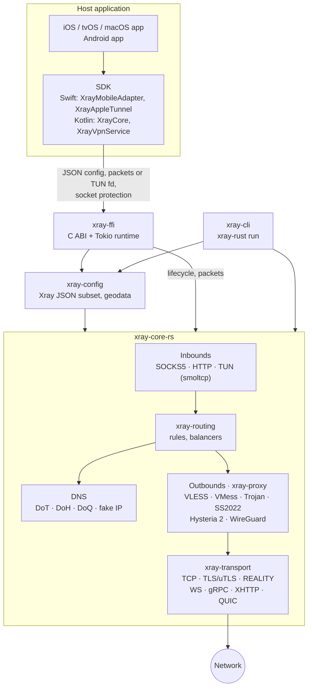
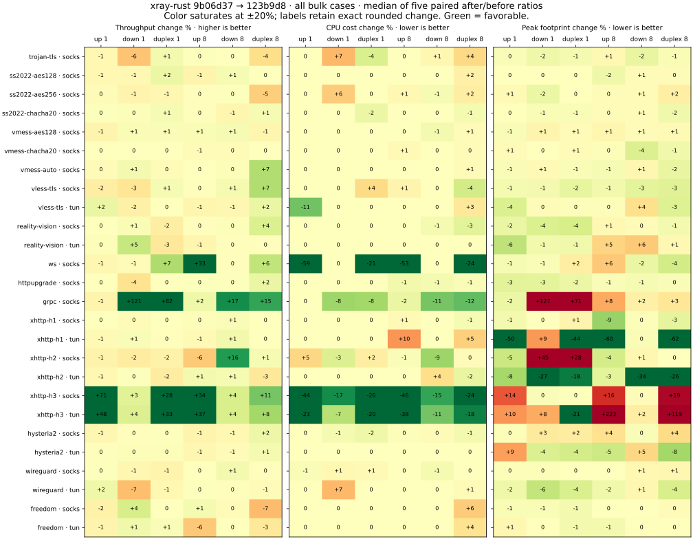

# xray-rust

**A Rust client core that reads Xray-style configurations, with Swift and Kotlin
SDKs for VPN apps on iOS, tvOS, macOS and Android.**

[](https://github.com/aimalygin/xray-rust/actions/workflows/ci.yml)
[](https://github.com/aimalygin/xray-rust/releases/latest)
[](https://central.sonatype.com/artifact/io.github.aimalygin/xray-rust-mobile)
[](LICENSE)


[Website](https://xray-rust.aimalygin.chatgpt.site) ·
[Mobile SDK](https://github.com/aimalygin/xray-rust-mobile) ·
[Status](docs/status.md) ·
[Config compatibility](docs/config-compatibility.md) ·
[Benchmarks](#benchmarks) ·
[Support the project](#support-the-project)

The development compatibility reference is [Xray-core v26.10.21](docs/xray-core-v26.10.21-migration.md).
Dated release and benchmark results retain their original references.

## Why xray-rust

- **Rust core with bounded resources.** Flow budgets, bounded queues,
  timeouts and backpressure bound the TUN path and relays; config, wire-format
  and FFI lifecycle code has [fuzz targets](fuzz/README.md).
- **Xray-compatible configs.** VLESS with REALITY, `xtls-rprx-vision` and
  XHTTP, plus VMess AEAD, Trojan, Shadowsocks 2022, Hysteria 2 and WireGuard
  clients. The parser accepts a [documented subset](docs/config-compatibility.md)
  and rejects unsupported fields with their JSON path instead of guessing.
- **Built for mobile.** A stable [C ABI](docs/ffi.md) with Swift Package and
  Android AAR adapters, a reference `NEPacketTunnelProvider` and `VpnService`,
  share-link import, and live connection inventory and diagnostics.
- **Measured against Xray-core.** Published, reproducible benchmarks: 4.6 MiB
  idle memory against 27.4 MiB for Xray-core, and 22.1 against 19.1 Gbps
  through VLESS + REALITY + Vision ([details](#benchmarks)).
- **Checked against the reference.** CI replays Go-oracle wire fixtures, and
  release candidates plus a weekly job run interoperability tests against a
  pinned Xray-core ([verification](docs/verification.md)).

> [!NOTE]
> `xray-rust` is a client-side core. It has not been independently security
> audited, and "supported" means implemented and covered by tests, not complete
> behavioral parity with every Xray-core release; see [project status](docs/status.md)
> and [Xray-core differences](docs/xray-core-differences.md).

## At a glance

Client outbounds and the transports and security layers each one can use.
Every cell covers a documented subset; [configuration compatibility](docs/config-compatibility.md)
lists the accepted values.

| Outbound | Stream transports | TLS | REALITY | Vision | UDP | Mux / XUDP |
| --- | --- | :---: | :---: | :---: | :---: | :---: |
| **VLESS** | RAW, WebSocket, HTTPUpgrade, gRPC, XHTTP (H1/H2/H3) | ✅ | ✅ RAW, gRPC, XHTTP | ✅ RAW¹ | ✅ | XUDP only² |
| **VMess AEAD** | RAW, WebSocket, HTTPUpgrade, gRPC, XHTTP | ✅ | ✅ RAW, gRPC, XHTTP | ➖ | ✅ | ✅ |
| **Trojan** | RAW, WebSocket, HTTPUpgrade, gRPC, XHTTP | ✅ | ✅ RAW, gRPC, XHTTP | ➖ | ✅ | ✅ |
| **Shadowsocks 2022** | RAW, WebSocket, HTTPUpgrade, gRPC, XHTTP | ✅ | ✅ RAW, gRPC, XHTTP | ➖ | ✅ | ✅ |
| **Hysteria 2** | Own QUIC carrier, Salamander, port hopping | QUIC | ➖ | ➖ | ✅ | ➖ |
| **WireGuard** | Own UDP carrier | ➖ | ➖ | ➖ | ✅ | ➖ |
| **SOCKS5** | RAW | ✅ | ❌ | ➖ | ✅ | ❌ |
| **HTTP `CONNECT`** | RAW, HTTP/1.1 only | ✅ | ❌ | ➖ | ❌ | ❌ |
| **Freedom, blackhole, DNS** | Direct | ➖ | ➖ | ➖ | ✅ | ➖ |

✅ supported subset · ❌ not supported · ➖ not applicable.
¹ Direct mode over RAW with TLS or REALITY; on other transports Vision requires
VLESS encryption, as in Xray. ² General VLESS Mux is not supported. Over XHTTP,
Mux carries UDP children only.

**Inbounds:** SOCKS5 (no-auth or RFC 1929 password, `CONNECT` and `UDP ASSOCIATE`),
HTTP `CONNECT`, a TUN packet API or file descriptor with a userspace TCP/UDP
stack, and Linux TPROXY.
**Routing and DNS:** Xray field rules with `geosite`/`geoip`, balancers with
`observatory` health checks, DoT/DoH/DoQ, fake IP and hot-swappable routing
policy. **Security extras:** uTLS-shaped ClientHellos, VLESS encryption
(ML-KEM-768/X25519), ClientHello fragmentation and UDP noise.

### Not supported yet

Mirrors the notable unsupported areas in [project status](docs/status.md#configuration-scope):

- Shadowsocks AEAD-2017, legacy VMess authentication, and server-side proxy protocols;
- generic HTTP/2, QUIC and KCP transports, and stream transports beyond RAW,
  WebSocket, HTTPUpgrade, gRPC and XHTTP;
- general VLESS Mux, reverse proxy, observatory command/API services, regex
  `leastLoad` costs, and outbound chaining outside the documented
  transport-layer TCP subset;
- HTTP inbound authentication and HTTP transparent proxy mode;
- full Xray DNS, policy/statistics, sniffing, and routing semantics.

<details>
<summary><b>Detailed scope and important limits</b></summary>

| Area | Implemented | Important limits |
| --- | --- | --- |
| Local inbounds | SOCKS5 no-auth or RFC 1929 password `CONNECT` and `UDP ASSOCIATE`, HTTP `CONNECT`, TUN | Password-protected SOCKS UDP requires a declared client endpoint; no HTTP inbound authentication or server-side Xray protocols |
| Outbounds | Freedom/direct, Xray-compatible blackhole, VLESS, Hysteria 2, WireGuard, Trojan, Shadowsocks 2022, VMess AEAD, SOCKS5 `CONNECT` and `UDP ASSOCIATE` with optional RFC 1929 credentials, HTTP/1.1 `CONNECT` with optional Basic credentials, DNS, health-aware selector groups including bounded `leastLoad`, and validated transport-layer TCP chaining | No Shadowsocks AEAD-2017, legacy VMess authentication, SOCKS outbound Mux, HTTP/2 `CONNECT` or HTTP outbound UDP, server-side proxy protocols, or chaining outside the documented TCP subset |
| Security and flow | TLS and REALITY with uTLS-shaped ClientHellos, `xtls-rprx-vision`, VLESS UDP and XUDP paths | Only the documented config subset; REALITY rejects the 14 fingerprints that carry no X25519 key share and warns on those without the X25519MLKEM768 share v26.10.21 servers require, while plain TLS accepts all 61 |
| Routing and DNS | Field rules with domain/IP/network/port matchers, `geosite`/`geoip`, atomic rule/geodata snapshot replacement, Xray `routing.balancers` plus bounded `observatory` URL health checks and `leastLoad`, cycle-free TCP outbound graph edges, Xray-style DNS server selection including routed `tls://` DoT, routed/local HTTP/2 DoH, and provider-local `quic+local://` DoQ, routed multi-address resolution, TTL-aware positive/negative cache with bounded stale-while-revalidate, `dns.hosts`, bounded fake IP, and DNS-outbound Direct/Drop/Return/Hijack policy | Full config and outbound/balancer topology replacement still requires a new core; no UDP/protocol-layer outbound chaining, `UseSystem` route probing, per-server cache policy, or full Xray DNS/routing parity |
| Mobile | Swift Package/Xcode sample for iOS, tvOS, and macOS; Android library and `VpnService` adapter | Signing, entitlements, VPN consent, foreground policy, and release packaging remain host-app responsibilities |
| Management | Development ABI 1.12 plus Swift/Kotlin expose protocol capability discovery, shared profile import and on-demand outbound probes alongside routing-policy replacement/snapshots, typed SOCKS TCP/UDP, HTTP TCP, and TUN TCP/UDP connection inventory, addressable close, cumulative per-outbound accounting, and equivalent typed TUN diagnostic queues | Policy updates affect new flows only; inventory is live and accounting is process-lifetime cumulative; no persistent connection history |

The [0.8 implementation and acceptance record](docs/v08-implementation-plan.md)
distinguishes passing host/CI checks from remaining physical-device gates, and
the [changelog](CHANGELOG.md) lists what `main` adds after the latest release.

</details>

### Platforms

| Platform | Integration | Artifact |
| --- | --- | --- |
| iOS 15+ | Swift Package, SwiftUI sample host, Packet Tunnel provider | Static XCFramework device and universal simulator slices |
| tvOS 17+ | Swift Package, SwiftUI sample host, Packet Tunnel provider | Static XCFramework device and universal simulator slices |
| macOS 13+ | Swift Package, app/menu-bar sample, Packet Tunnel provider | Universal `arm64 + x86_64` static XCFramework slice |
| Android API 24+ | Kotlin wrapper, JNI bridge, `VpnService` adapter | Four-ABI AAR with 16 KiB-aligned native libraries |

These are reference integrations: production apps provide their own signing,
entitlements or manifest policy, VPN consent and distribution. The lower-level
Apple products also run on macOS 11 and 12; see [platform status](docs/status.md#platform-status).

## Architecture



The host owns the VPN interface, consent and profile storage; the core parses
the profile once per handle, routes each flow and dials the selected outbound.
When the Android core is created with a `VpnService`, every outbound socket
passes through `VpnService.protect(fd)` before use. See [architecture](docs/architecture.md) for crate boundaries and
data paths, and the [C ABI contract](docs/ffi.md) for lifecycle and threading.

## Benchmarks

Synthetic same-host comparison from the [2026-10-30 three-engine group](docs/benchmarks/results/2026-10-30-v26.10.21-three-engine/README.md):
xray-rust `123b9d8d` against Xray-core `v26.10.21` and stable sing-box
`v1.14.4` on an Apple M6 with 32 GB RAM and macOS 27.0. Values are medians of
five release runs.

| Scenario (lower is better unless noted) | xray-rust | Xray-core | sing-box |
| --- | ---: | ---: | ---: |
| Idle memory, MiB | **4.6** | 27.4 | 30.8 |
| 1,000 idle SOCKS flows, MiB | **22.7** | 78.6 | omitted |
| Memory with real geodata, MiB | **9.9** | 33.4 | unsupported |
| VLESS + REALITY + Vision bulk, Gbps (higher is better) | **22.1** | 19.1 | omitted |
| VLESS + REALITY + Vision CPU, ms/GiB | **480** | 500 | omitted |
| UDP round trip, µs | **23** | 41 | 29 |
| Plain TCP bulk through SOCKS, Gbps (higher is better) | 90.4 | 73.3 | **100.0** |
| Reconnect burst setup, µs | 1,333 | **987** | 1,313 |

<picture>
  <source media="(prefers-color-scheme: dark)" srcset="docs/benchmarks/results/2026-10-30-v26.10.21-three-engine/media/memory-rss-dark.svg">
  
</picture>

<picture>
  <source media="(prefers-color-scheme: dark)" srcset="docs/benchmarks/results/2026-10-30-v26.10.21-three-engine/media/reality-throughput-dark.svg">
  
</picture>

<picture>
  <source media="(prefers-color-scheme: dark)" srcset="docs/benchmarks/results/2026-10-30-v26.10.21-three-engine/media/geo-memory-dark.svg">
  
</picture>

What these numbers do not show:

- They are localhost process microbenchmarks, not WAN, packet loss, mobile
  energy or TUN measurements.
- Stable sing-box is omitted from REALITY: its client removes the
  X25519MLKEM768 key share that v26.9.8 and later servers require. Its
  1,000-flow runs did not complete on this host.
- Setup is slower than Xray-core's: xray-rust replies to SOCKS `CONNECT`
  after routing and dialing, Xray-core before them (see the measurement
  asymmetry note in [benchmark methodology](docs/benchmarks.md)).
- At `123b9d8d`, 32 parallel XHTTP H3 uploads peaked at 163.3 MiB against
  49.9 for Xray-core; a later shared send budget brought that to 87.7 MiB
  ([send-budget report](docs/benchmarks/results/2026-10-30-xhttp-h3-send-budget/README.md)).
- In the [0.8 protocol comparison](docs/benchmarks/results/2026-09-30-v08-protocols/README.md)
  (1050 full-client trials) memory is lower throughout, but Shadowsocks 2022
  and VMess bulk throughput and CPU targets remain unmet; see the
  [0.8 performance record](docs/v08-performance.md).

Latency, CPU, setup and stream-transport tables are in the
[dated result group](docs/benchmarks/results/2026-10-30-v26.10.21-three-engine/README.md);
the method is in [benchmark methodology](docs/benchmarks.md). For 0.7
regression checks and Hysteria2/WireGuard comparisons, see the
[0.7 performance record](docs/v07-performance.md). The
[2026-08-31 RC4 group](docs/benchmarks/results/2026-08-31-v26.7.28/README.md),
the earlier Xray-core v26.5.9 and the xray-rust DNS charts remain available as
[historical evidence](docs/benchmarks/results.md).

<details>
<summary><b>Performance-branch and XHTTP H3 memory reports (2026-10-30/31)</b></summary>

The [2026-10-30 performance-branch report](docs/benchmarks/results/2026-10-30-perf-branch/README.md)
compares `main` at `9b06d374` with the branch at `123b9d8d` on one Apple M6,
against the same Xray v26.10.21 server and driver: **200 scenarios, five runs
per version, 2,000 accepted trials**. WebSocket uploads use 53–59% less CPU
per byte, one-flow gRPC downloads run 2.2× faster, XHTTP H3 uploads run 34–71%
faster at 23–46% less CPU, and XHTTP H1 uploads through TUN peak at up to 62%
less memory. Faster gRPC and XHTTP H3 flows also hold more data, up to 9.6 →
31.9 MiB for eight XHTTP H3 uploads through TUN, and XHTTP H1 uploads through
TUN cost 9.5% more CPU. The report explains each cost and keeps every repeat
and rejected attempt; 131/156 bulk cases change throughput by at most 5%. This
is a Rust before/after comparison; the earlier
[v26.10.21 migration comparison](docs/benchmarks/results/2026-10-27-v26.10.21-migration/README.md)
remains with its erratum. A later change on the branch shares one send budget
between XHTTP H3 uploads: 32 parallel uploads now peak at 87.7 instead of
162.1 MiB RSS and 32 duplex transfers at 78.2 instead of 140.6, at the same
throughput ([send-budget report](docs/benchmarks/results/2026-10-30-xhttp-h3-send-budget/README.md)).
On Linux, where quinn reserved 2.9 MiB of receive buffer for every XHTTP H3
connection, 32 parallel downloads now peak at 114.6 instead of 154.3 MiB at
the same throughput
([receive-buffer report](docs/benchmarks/results/2026-10-30-xhttp-h3-receive-batch/README.md)).
A vendored h3 no longer buffers downloads outside QUIC flow control: 32
downloads now peak at 95.8 instead of 112.5 MiB, and the longer they run
the more that saves ([download-memory report](docs/benchmarks/results/2026-10-31-xhttp-h3-download-memory/README.md)).
Concurrent downloads now share a receive budget that holds only readers
that fall behind: 32 downloads peak at 50.0 instead of 96.7 MiB and 32
duplex transfers at 63.6 instead of 110.6, while one-, eight-flow and
long-path downloads keep their speed ([receive-budget report](docs/benchmarks/results/2026-10-31-xhttp-h3-receive-budget/README.md)).
On macOS, where readers keep up, none of these three changes moves the XHTTP H3
numbers beyond run-to-run spread
([macOS re-check](docs/benchmarks/results/2026-10-31-xhttp-h3-macos-recheck/README.md),
[receive-budget collector run](docs/benchmarks/results/2026-10-31-xhttp-h3-receive-budget/README.md)).



</details>

## Quick start

### CLI

Build the `xray-rust` binary, export a starting profile, validate it and run it:

```sh
cargo build --locked -p xray-cli          # produces target/debug/xray-rust
target/debug/xray-rust config example vless-tls > client.json
target/debug/xray-rust config check --config client.json --json
target/debug/xray-rust run -config client.json
```

`config check` parses the profile without starting the core or touching the
network, and reports problems with their JSON path. The exported examples
(`socks-direct`, `vless-tls`, `hysteria2`, `wireguard`, `xhttp-download`,
`dns-routing`, …) use synthetic endpoints and credentials: supply your own
before running. See [configuration tooling](docs/config-tooling.md).

For a credential-free smoke run, the loopback example starts a SOCKS5 listener
at `127.0.0.1:1080`, routes directly through the host network, and waits for
`Ctrl-C`:

```sh
cargo run --locked -p xray-cli -- run \
  -config examples/freedom.json
```

For VLESS, copy a synthetic fixture from `tests/fixtures/configs/` outside the
repository and replace every placeholder. Never commit a live UUID, key, short
ID, endpoint, or subscription URL.

### Android

Prebuilt SDK packages are published from
[`xray-rust-mobile`](https://github.com/aimalygin/xray-rust-mobile); each mobile
release pins a reviewed core commit and ships checksums and a release manifest.
Stable versions are on Maven Central, no GitHub credentials needed; each
release also carries the standalone AAR:

```kotlin
dependencies {
    implementation("io.github.aimalygin:xray-rust-mobile:0.8.1")
}
```

Subclass the reference `VpnService` and register it in your manifest:

```kotlin
class AppVpnService : XrayVpnService() {
    fun connect(configJson: String) {
        startXrayTunnel(
            configJson = configJson,
            tunRuntimeProfile = XrayTunRuntimeProfile.Mobile,
        )
    }

    override fun onXrayTunnelStartFailed(error: Throwable) {
        // Report a sanitized failure to the host app.
    }
}
```

The host app still owns `VpnService.prepare`, the foreground notification and
service type. See the [mobile SDK guide](https://github.com/aimalygin/xray-rust-mobile#android-with-gradle)
and [Android integration](platform/android/README.md).

### Apple

Add the Swift Package:

```swift
dependencies: [
    .package(
        url: "https://github.com/aimalygin/xray-rust-mobile.git",
        exact: "0.8.1"
    ),
]
```

It provides the low-level `XrayMobileAdapter`, shared profile and storage APIs
in `XrayAppleShared`, and the ready-to-subclass `XrayAppleTunnel`
packet-tunnel provider. A Packet Tunnel extension can use it directly:

```swift
import XrayAppleTunnel

final class PacketTunnelProvider: XrayPacketTunnelProvider {}
```

Starting a real tunnel needs signing and the Packet Tunnel Network Extension
entitlement. See the [mobile SDK guide](https://github.com/aimalygin/xray-rust-mobile#apple-platforms-with-swift-package-manager)
and [Apple integration](platform/apple/README.md).

<details>
<summary><b>Build the mobile SDKs and samples from source</b></summary>

Prerequisites:

- Rust via `rustup`; [`rust-toolchain.toml`](rust-toolchain.toml) selects the
  exact toolchain used by the workspace.
- A C toolchain for native dependencies.
- Go only for deterministic oracle tools and optional Xray-core interoperability
  tests.
- Xcode for Apple artifacts, or JDK 17+, Android SDK 35, CMake 3.22.1, and NDK
  26.3.11579264 for Android artifacts.

Apple:

```sh
scripts/check-mobile-toolchains.sh --apple
scripts/build-apple-xcframework.sh
scripts/fetch-geodata.sh
open platform/apple/XrayClient/XrayClient.xcodeproj
```

The Xcode project consumes
`target/mobile/apple/XrayRust.xcframework` through the local Swift Package.
Choose the `XrayClient`, `XrayClientTv`, or `XrayClientMac` scheme. The
committed project builds unsigned under placeholder `org.example` identifiers;
to sign it, copy
`platform/apple/XrayClient/Config/Local.xcconfig.example` to `Local.xcconfig`
in the same directory and set your bundle prefix and Team ID there. That file
is git-ignored, so your identity stays out of the repository and Xcode leaves
nothing to commit. Register App IDs matching your prefix first — the tunnel
targets request the `packet-tunnel-provider` entitlement. The geodata download is needed by the checked-in Xcode
resource build phases; profiles that do not use geodata can omit those files in
a custom host project. See [Apple integration](platform/apple/README.md).

Android:

```sh
scripts/check-mobile-toolchains.sh --android
scripts/build-android-adapter.sh
```

This produces
`platform/android/xraymobile/build/outputs/aar/xraymobile-debug.aar`. See
[Android integration](platform/android/README.md).

</details>

## Project layout

```text
crates/
├── xray-cli               xray-rust command: run, config check/example/contract
├── xray-config            Xray JSON subset and geodata parser with path-aware diagnostics
├── xray-core-rs           lifecycle, inbounds, routing, outbound selection, DNS, TUN runtime
├── xray-ffi               stable C ABI with an embedded Tokio runtime
├── xray-proxy             client protocol wire formats: SOCKS/HTTP, VLESS, VMess, Trojan, SS2022, Hysteria 2, WireGuard, Mux
├── xray-transport         TCP, TLS, REALITY, DNS, dialing and shaped ClientHellos
├── xray-routing           routing matchers and policy evaluation
├── xray-tun               bounded packet queues and TUN abstractions
├── xray-utls              uTLS ClientHello profile data
├── xray-vless-encryption  VLESS encryption client
├── xray-wireguard         WireGuard client with a userspace TCP/UDP interface
├── xray-runtime           shutdown coordination
└── xray-bench             benchmark harness against Xray-core and sing-box
platform/
├── android                Kotlin wrapper, JNI bridge, VpnService and device-test apps
└── apple                  Swift Package, Packet Tunnel provider and Xcode sample app
tools/                     Go oracles and reference builds for wire fixtures
tests/                     shared fixtures and compatibility data
fuzz/                      cargo-fuzz targets
scripts/                   build, interop, benchmark and release checks
docs/                      status, compatibility, architecture, evidence
vendor/                    vendored upstream crates patched into the workspace
website/                   project website source
```

## Documentation

- [Development roadmap](docs/roadmap.md)
- [Status and supported features](docs/status.md)
- [Architecture](docs/architecture.md)
- [Configuration compatibility](docs/config-compatibility.md)
- [Xray-core differences and verification gaps](docs/xray-core-differences.md)
- [Configuration contract and CLI tooling](docs/config-tooling.md)
- [C ABI lifecycle and ownership](docs/ffi.md)
- [Verification](docs/verification.md)
- [Mobile testing](docs/mobile-testing.md)
- [Benchmark methodology](docs/benchmarks.md)
- [Benchmark results](docs/benchmarks/results.md)
- [Changelog](CHANGELOG.md)
- [Contributing](CONTRIBUTING.md)
- [Security policy](SECURITY.md)
- [Third-party notices](THIRD_PARTY_NOTICES.md)

## Contributing and testing

Read [CONTRIBUTING.md](CONTRIBUTING.md) first. Run the same Rust checks used by CI:

```sh
cargo fmt --all -- --check
cargo clippy --workspace --all-targets --all-features --locked -- \
  -D warnings -W clippy::perf -W clippy::suspicious
cargo test --workspace --exclude xray-rust-fuzz --all-targets --locked
```

For a self-contained data-path test that needs no external server:

```sh
cargo test --locked -p xray-core-rs \
  --test runtime_data_path_tests \
  socks_client_reaches_echo_target_through_freedom_outbound
```

The default suite is hermetic. Beyond it, [verification](docs/verification.md)
documents the Go-oracle fixture replay (`scripts/verify-oracle-fixtures.sh`),
local interoperability against a pinned Xray-core checkout
(`scripts/check-*-interop.sh`), fuzzing and live-node tests;
[mobile testing](docs/mobile-testing.md) covers the SDKs and physical devices.
Report vulnerabilities privately as described in [SECURITY.md](SECURITY.md).

## Support the project

If you find this project useful, consider supporting its development with a donation:

- **TON (TON network):** UQCIpU1qagwDltuqPUZh4EuI2zXvismk6esCCTWUVphj_o4y
- **ETH (Ethereum network):** 0x96A9a65E188c439a95267a3dA6920884C530f57f
- **BTC (Bitcoin network):** bc1qxxk42z2ty8wx702sk5cammwhchl95y39kf2wdc
- **SOL (Solana network):** D4xFX2GwPniSetHZWn2XRTBaSM6m1k1wMtacr6TMVHQD

Thank you for your support!

## License

The project source is licensed under the
[Mozilla Public License 2.0](LICENSE). Downloaded geodata and other third-party
components remain under their respective licenses; see
[THIRD_PARTY_NOTICES.md](THIRD_PARTY_NOTICES.md).
