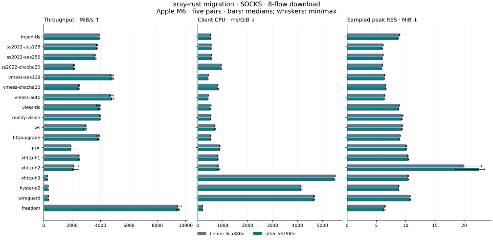
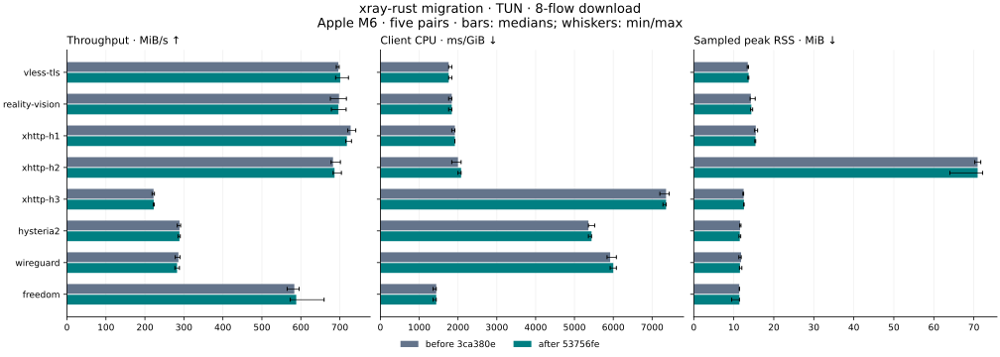
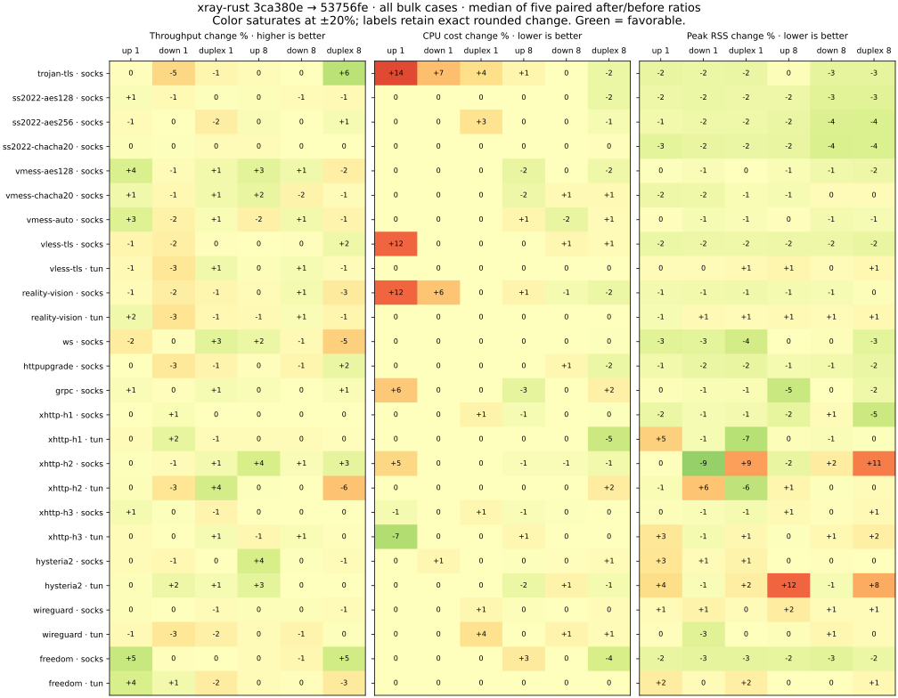
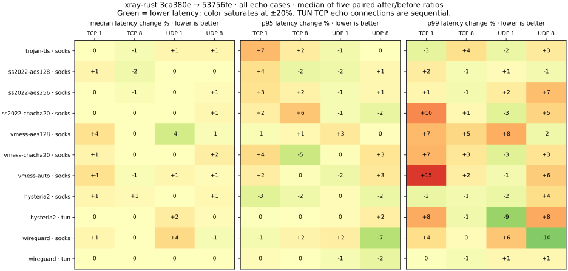

# xray-rust before/after the Xray-core v26.10.21 migration

Measured **2026-10-27 21:42–2026-10-28 02:42 America/Chicago** (2026-10-28
02:42–07:42 UTC). The directory uses the local campaign start date.

All **200 cases × two Rust versions × five runs = 2,000 accepted trials** passed
payload, process-cleanup, binary-identity and ambient-load checks on one Mac.
There is no broad throughput shift in this matrix: 152/156 bulk cases have a
median paired change within ±5%, and all 44 echo cases have median-latency
changes within ±5%. There are memory and latency-tail signals that need a
separate follow-up; this is not a proof of performance equivalence.

This compares the **Rust client before and after migration against one common
new Go server**. It does not compare the speed of old and new Go Xray clients.
The historical three-engine reports and charts remain unchanged.

## Results

Each change below is the median of five matched `after / before` ratios.
The cross-case median is unweighted; it is not an aggregate speedup or a
traffic-weighted score. The ±5% column is descriptive, not a predeclared pass
budget or an equivalence test.

| Metric | Cases | Median case change | Range of case changes | Cases within ±5% |
| --- | ---: | ---: | ---: | ---: |
| Bulk throughput | 156 | -0.01% | -6.35% to +6.40% | 152/156 |
| Bulk CPU per GiB | 156 | +0.00% | -7.14% to +14.29% | 148/156 |
| Bulk sampled peak RSS | 156 | -0.72% | -9.02% to +12.43% | 145/156 |
| Echo median latency | 44 | +0.00% | -4.44% to +4.44% | 44/44 |
| Echo p95 latency | 44 | +0.18% | -6.67% to +6.88% | 40/44 |
| Echo p99 latency | 44 | +1.09% | -10.02% to +15.42% | 32/44 |

The following observations deserve attention. Absolute columns are separate
five-run medians; the paired change can differ from their ratio. The full
matrix and every repeat are in [summary.json](summary.json) and
[results.csv](results.csv).

| Case | Metric | Before median | After median | Paired change | Paired range / descriptive bootstrap interval |
| --- | --- | ---: | ---: | ---: | --- |
| `hysteria2-tun-upload-8` | RSS, MiB | 19.11 | 21.48 | +12.43% | +2.88% to +14.51% |
| `hysteria2-tun-full-duplex-8` | RSS, MiB | 21.67 | 23.42 | +8.07% | +7.17% to +15.36% |
| `xhttp-h2-socks-full-duplex-8` | RSS, MiB | 25.78 | 26.94 | +11.09% | +0.06% to +39.48% |
| `vmess-auto-socks-tcp-latency-1` | p99, µs | 225.00 | 232.00 | +15.42% | +1.57% to +24.04% |
| `xhttp-h2-tun-full-duplex-8` | Throughput, MiB/s | 1,031.40 | 962.43 | -6.35% | -14.06% to +7.41% |
| `wireguard-tun-download-1` | Throughput, MiB/s | 195.47 | 187.19 | -2.98% | -6.19% to -0.61% |
| `freedom-tun-full-duplex-8` | Throughput, MiB/s | 858.65 | 829.90 | -2.65% | -6.35% to -0.29% |
| `trojan-tls-socks-upload-1` | CPU, ms/GiB | 280.00 | 320.00 | +14.29% | -12.50% to +16.67% |

Hysteria2 TUN upload and duplex RSS increased in all five matched pairs; the
absolute median differences are about 2.38 and 1.75 MiB. XHTTP H2 SOCKS duplex
also has higher RSS in every pair but a wide range. VMess auto TCP p99 is
higher in all five pairs, while its separate medians move from 225 to 232 µs;
reporting only those medians would hide the paired result. These are observed
signals, not isolated causal diagnoses of a code change.

The largest bulk-throughput point decrease, XHTTP H2 TUN duplex with eight
flows, has a paired range crossing zero. Smaller consistent decreases also
exist, including WireGuard TUN download and the Freedom TUN duplex control
above. The control change is another reason not to attribute every delta to
the migration. CPU counters have 10 ms resolution on this host; a small
absolute step in a short run can produce a large percentage (for example,
Trojan upload's 70 to 80 ms median sampled CPU). No claim of a general CPU
improvement or a release-wide non-regression gate follows from this campaign.

Recommended follow-up: independently repeat the flagged memory/tail cases
with A/A controls and longer sampling on a quiet machine, then profile only
signals that persist. Those additional measurements are not substituted into
this five-run dataset.

## Charts

The download charts are one common slice: eight active flows, median bars and
min/max whiskers. Heatmaps cover all 156 bulk cases and all 44 echo cases, so
an isolated download slice cannot conceal other changes. Heatmap colors
saturate at ±20%; values are rounded percentage changes. Green means the
favorable direction of the metric, not statistical significance.









PNG exports: [SOCKS](socks-download-8.png), [TUN](tun-download-8.png),
[bulk](bulk-changes.png), [latency](latency-changes.png).

## Frozen inputs and host

| Component | Source |
| --- | --- |
| Rust before | `3ca380e7e32d82cfff55f38698117dba8bef077b` |
| Rust after | `53756feea4868e77114f71688cb27b34b8e57ffb` |
| Common Rust benchmark driver | `53756feea4868e77114f71688cb27b34b8e57ffb` |
| Common Go Xray server | v26.10.21, `1b1647cd9ddf0abc34b981d4611fc03bcac1ca74` |

The host is **Apple M6 / Mac18,5, 12 logical CPUs, 32 GiB RAM, macOS 27.0
(26A425), AC power**. Rust is **1.96.0**, Cargo **1.96.0**, and Go **1.27.3**.
Both Rust engines use the locked release profile: thin LTO, one codegen unit,
stripped symbols, incremental compilation disabled and no RUSTFLAGS.
The before command builds `-p xray-cli`; the after command builds `-p xray-cli
-p xray-bench`. A retained `cargo tree --locked --offline` comparison confirms
that adding the driver changes no features in the 255 CLI dependency-package
entries. Cargo.lock still matches the measured after revision.

Executable SHA-256 values:

| Binary | SHA-256 |
| --- | --- |
| before | `6424ca70e93a3ecc1e9978c360b79482b8689c6e3ca0d8485b6e3c4786bf6c87` |
| after | `a19da22fc36b67c2edab8b59aee35cc9e7e1fc851046bea708925a5a232a67ac` |
| harness | `d1fb8e2f1678a21bff267a41056e60f99f89500d4068ef7896a892a501d16149` |
| reference | `b8c58f14180eb0cad5665fa2cefb7d10897eec945d007212a053fc1de2257ee8` |
| origin | `9e2f46e0a0378ff6a15ae5601f897b6feac2c342a161507667834a7dc5e67922` |

The archive contains the exact `build-inputs.json`, including source trees,
Cargo.lock hashes, full toolchain versions, build commands, clean Go VCS
metadata and the local REALITY cover-origin source/hash. Binaries were copied
out of the shared target directory and hash-checked before and after blocks.
The collector revisions are preserved in Git history and each manifest;
controller scripts and build-feature evidence are under `provenance/` in the
archive. The first accepted Trojan block predates cooperative UI pausing;
later cases use the same frozen driver and workloads with paused progress.

## Workloads and pairing

There are 18 profiles: Trojan/TLS; SS2022 AES-128, AES-256 and ChaCha20;
VMess AES-128, ChaCha20 and auto; VLESS/TLS; REALITY/Vision; WS; HTTPUpgrade;
gRPC; XHTTP H1/H2/H3; Hysteria2; WireGuard; and Freedom controls.
SOCKS covers all profiles. TUN bulk covers VLESS/TLS, REALITY/Vision, XHTTP,
Hysteria2, WireGuard and Freedom; TUN echo covers Hysteria2 and WireGuard.

| Workload | Connections | Iterations per connection | Payload | Data per flow/direction |
| --- | --- | ---: | ---: | ---: |
| SOCKS TCP upload/download/duplex | 1, 8 | 4096 | 65536 bytes | 256 MiB |
| TUN TCP upload/download/duplex | 1, 8 | 256 | 65536 bytes | 16 MiB |
| TCP echo | 1, 8 | 1000 | 1024 bytes | 1000 round trips |
| UDP echo | 1, 8 | 1000 | 1200 bytes | 1000 round trips |

A fresh client is started for each trial; each before/after pair shares fresh
server/config fixtures. Pair order alternates AB/BA using the original global
case index. Five repeats create a 3/2 order imbalance within a case, which
cancels across adjacent cases. The driver, server, payload sizes, default
worker settings and validation are identical for the two clients.

SOCKS uses a validated warmup, plus a validated preface for bulk tests. TUN
has neither warmup nor preface and runs through the synthetic inherited-FD
path without modifying host routes. TUN TCP echo's eight connections are
**sequential**, not eight active flows; bulk and UDP use the recorded
concurrency. Duplex throughput counts both sent and received validated bytes.
UDP echo is not a saturation or packet-loss capacity test.

REALITY uses a local TLS 1.3/H2 cover origin and fresh per-pair X25519 keys;
there is no public Internet cover endpoint. The generic `protocol-run` bulk
payload is deterministic synthetic TCP data, without an inner TLS session to
the traffic target. This exercises the generic Vision relay and is **not**
the historical inner-TLS/direct-copy headline workload. Do not compare these
REALITY numbers directly with the old 15.2 Gbps chart.

## Quality, retained attempts and statistical limits

The accepted set comprises **191 blocks**: one ten-case Trojan block and
190 single-case blocks. All successful full blocks are accepted. **24 rejected
full attempts (143 recorded trials)** and **three smoke attempts (437 trials)**
are retained and excluded from performance summaries. The final smoke passed
all 400 version/case combinations. A complete failed block is excluded even
when some earlier trials in that attempt passed. Selection never uses speed,
CPU or RSS values, and retries are capped at five attempts per case.

The full-run gate rejects protocol/byte failures, leftover processes,
observer failures, any observed compiler, an external process using at least
100% of one CPU core, or aggregate external CPU of at least 200%. The accepted
one-second samples have median aggregate external CPU **19.42%**, maximum
**180.05%**, and maximum single-process CPU **98.96%**. This is a normal desktop
session with retained lighter activity, not an idle laboratory. The monitor
cannot detect every short-lived process or brief spike. `pmset` did not report
a thermal/performance warning; this is not continuous temperature telemetry.

Rejected attempts included progress-window rendering and macOS background
services. Progress was moved between completed pairs, with extra settling
waits and occasional silent batches to avoid contaminating a measurement.
Those waits are outside measured pairs; the runtime inputs and quality gates
were unchanged. Temporary sleep-prevention assertions followed the campaign
process and ended with it. No unrelated process was stopped.

RSS is the client's peak **sampled** resident set during the measured workload
(100 ms sampling), not physical footprint, idle memory or total machine
memory. CPU is the client's sampled active CPU; startup time, startup CPU and
total sampled client CPU are separately retained. Startup and process-lifetime
CPU windows are not identical to the bulk transfer window. Fixture-server,
driver, cover-origin and observer resource use is not attributed to the client.

Each metric retains all five samples, median, minimum and maximum, plus the
five matched ratios. The exact empirical percentile bootstrap enumerates all
`5^5` resamples. With five pairs its 95% interval reaches the observed ratio
minimum and maximum; it is a low-resolution descriptive interval, not an
adjusted population-confidence claim. Hundreds of comparisons are made
without multiplicity adjustment. Small deltas, coarse CPU steps and tail
signals need independent confirmation. No result here establishes SDK/device
energy, WAN performance, a release gate or parity with a different engine.
The older M3 Pro/18 GB campaigns use another host and workload set and remain
historical evidence, not a migration baseline.

## Verification and reproduction

[measurements.tar.gz](measurements.tar.gz) contains numeric results for every
recorded attempt, redacted manifests, exact build inputs and controller
provenance. [evidence-index.json](evidence-index.json) identifies every accepted,
rejected and smoke block and hashes the archive and every member. Generated
configs, private fixture keys, application logs, unrelated process names and
unrelated process PIDs are not published. The complete private campaign,
binaries and logs remain in the ignored local benchmark directory.

Archive SHA-256: `fd27b8a18d5eeb2990330cd3074b5cdcec035b6c1c30c5043480f76cb516d9cd`.

From the repository root, using Python 3.11+:

```sh
python3 scripts/publish-migration-benchmarks.py verify \
  --report docs/benchmarks/results/2026-10-27-v26.10.21-migration

# Optional: matplotlib==3.10.8 and numpy==2.3.5 for exact chart environment.
python3 scripts/publish-migration-benchmarks.py charts \
  --report docs/benchmarks/results/2026-10-27-v26.10.21-migration
```

Verification reconstructs the summary from the archive, checking all 200
cases, 2,000 unique trials, five pairs, exact byte counts, stock settings,
source and binary pins, host identity, ordering and load/cleanup checks.
To collect a new independent campaign, use the build/input and collector
commands in [the benchmark guide](../../../benchmarks.md#paired-migration-measurements).
Use a new output/report directory; never overwrite this dated evidence.
