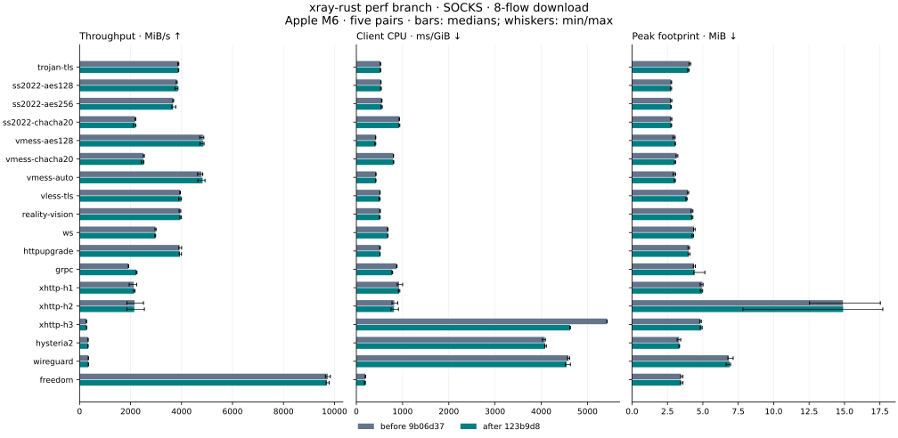
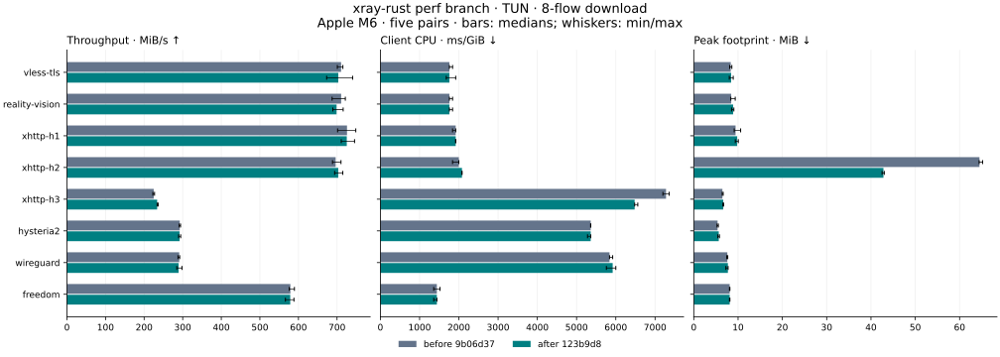
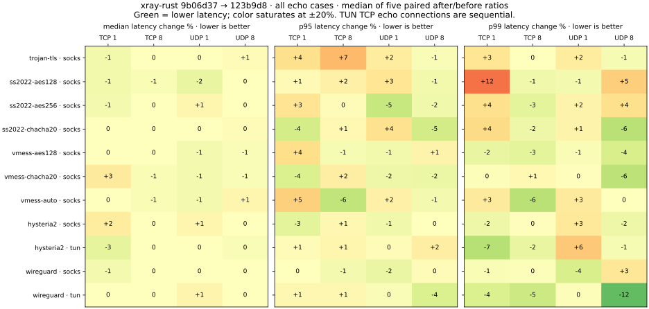

# xray-rust main against the 2026-10-30 performance branch

Measured **2026-10-30 07:53–12:15 America/Chicago** (12:53–17:15 UTC).

All **200 cases × two Rust versions × five runs = 2,000 accepted trials**
passed payload, process-cleanup, binary-identity and ambient-load checks on
one Mac, with the driver, server and matrix of the
[v26.10.21 migration report](../2026-10-27-v26.10.21-migration/README.md).
"Before" is `main` at `9b06d374`; "after" is the branch at `123b9d8d`.

The branch's changes show where they were aimed, and nowhere else beyond the
usual spread:

- WebSocket uploads cost 53–59% less client CPU per byte, duplex 21–24% less.
- gRPC downloads with one flow run 2.2× faster (812 → 1,792 MiB/s) and
  duplex 1.8× faster; eight flows gain 15–17% at 11–12% less CPU.
- XHTTP H3 uploads run 34–71% faster at 23–46% less CPU; every H3 transfer
  costs less CPU per byte.
- XHTTP H1 uploads and duplex transfers through TUN peak at 44–62% less
  memory; XHTTP H2 downloads through TUN at 27–34% less.

They cost memory where windows or buffers now fill: gRPC and XHTTP H3 flows
that run faster also hold more data, up to 9.6 → 31.9 MiB for eight XHTTP H3
uploads through TUN. XHTTP H1 uploads through TUN cost 9.5% more CPU for
their memory saving, and single XHTTP H2 SOCKS downloads stay 2% below main.
Each is explained below. 131/156 bulk cases change throughput by at most 5%,
and all 44 echo cases keep their median latency within ±5%.

This compares two Rust clients against one Go server. It is not a
three-engine comparison; see the [2026-10-30 three-engine group](../2026-10-30-v26.10.21-three-engine/README.md)
for that.

## How this campaign got here

This is the third campaign for the branch. The first two found two bugs in
it; neither of their datasets is published, but their controller logs are in
the archive's `provenance/`.

1. **After = `d1fcd45d`, stopped at block 109.** `grpc-socks-full-duplex-1`
   lost its connection in 8 of 25 trials. grpc-go's server answered with
   `GOAWAY ENHANCE_YOUR_CALM "too_many_pings"`: the new BDP estimator started
   a sample when the stream was read, so draining buffered data sent pings
   after the server had written everything. `84997341` starts samples as DATA
   arrives, as grpc-go does.
2. **After = `84997341`, completed.** Its XHTTP H2 SOCKS downloads were 16%
   slower than main with one flow and 27% with eight, at 18–29% more CPU.
   Interleaved runs of isolated builds put the cause in `53a0ae2b`, which
   returned stream credit every 4 KiB as Go's client does: our reader takes
   16–128 KiB at a time, so every read sent a WINDOW_UPDATE through its own
   TLS record. `971379b7` returns credit in sixteenths of the window instead.
3. **After = `123b9d8d`**, the fix plus a publisher change: this dataset.

The diagnostics behind step 2 and behind the XHTTP H3 memory attribution
below. Medians of four (three for H3) interleaved runs of the collector's
own workload; they are not part of the verified dataset:

| Build | XHTTP H2 SOCKS download ×1 | CPU, ms/GiB |
| --- | ---: | ---: |
| main `9b06d374` | 1,076 MiB/s | 1,120 |
| `69acd7c2` | 1,073 MiB/s | 1,080 |
| `068fcc30` | 1,077 MiB/s | 1,080 |
| `53a0ae2b`, credit every 4 KiB | 911 MiB/s | 1,280 |
| `b01fcd06` | 912 MiB/s | 1,300 |
| fix `71ade074` (the code of `971379b7`) | 1,047 MiB/s, main 1,083 | 1,120, main 1,120 |

| Build | XHTTP H3 TUN upload ×8 | CPU, ms/GiB | Peak footprint |
| --- | ---: | ---: | ---: |
| main `9b06d374` | 263 MiB/s | 7,440 | 9.6 MiB |
| `e98fe285` | 265 MiB/s | 7,440 | 9.2 MiB |
| `b01fcd06`, connected socket | 365 MiB/s | 4,560 | 31.6 MiB |

At an added 113 ms against Go's client (a separate runner, see
[issue #28](../../../issue28-client-comparison.md)), the fixed XHTTP H2 client
downloads at 261.9 Mbit/s against Go's 253.0 and main's 181.5; the 4 KiB
version measured 268.5.

## Results

Each change below is the median of five matched `after / before` ratios.
The cross-case median is unweighted; it is not an aggregate speedup or a
traffic-weighted score. The ±5% column is descriptive, not a pass budget.

| Metric | Cases | Median case change | Range of case changes | Cases within ±5% |
| --- | ---: | ---: | ---: | ---: |
| Bulk throughput | 156 | -0.01% | -6.86% to +121.18% | 131/156 |
| Bulk CPU per GiB | 156 | +0.00% | -59.09% to +9.52% | 128/156 |
| Bulk peak footprint | 156 | -0.43% | -61.53% to +223.02% | 125/156 |
| Bulk sampled peak RSS | 156 | +1.05% | -58.02% to +139.63% | 134/156 |
| Echo median latency | 44 | +0.00% | -2.60% to +2.56% | 44/44 |
| Echo p95 latency | 44 | +0.44% | -5.91% to +7.01% | 40/44 |
| Echo p99 latency | 44 | -0.54% | -12.18% to +11.66% | 36/44 |

Peak footprint is the client's exact lifetime peak physical footprint
(`proc_pid_rusage`); sampled RSS is kept in the CSV.

### Costs

Every unfavorable case whose five pairs all point the same way and whose
median moves at least 5%. Absolute columns are separate five-run medians.

| Case | Metric | Before | After | Paired change | Descriptive interval |
| --- | --- | ---: | ---: | ---: | --- |
| `xhttp-h3-tun-upload-8` | Peak footprint, MiB | 9.62 | 31.94 | +223.02% | +201.79% to +254.30% |
| `grpc-socks-download-1` | Peak footprint, MiB | 3.05 | 6.94 | +126.63% | +100.00% to +146.91% |
| `xhttp-h3-tun-full-duplex-8` | Peak footprint, MiB | 13.70 | 29.97 | +119.45% | +113.41% to +131.50% |
| `grpc-socks-full-duplex-1` | Peak footprint, MiB | 5.20 | 8.89 | +70.87% | +66.17% to +163.44% |
| `xhttp-h2-socks-full-duplex-1` | Peak footprint, MiB | 6.02 | 7.62 | +27.64% | +24.81% to +46.85% |
| `xhttp-h3-socks-upload-8` | Peak footprint, MiB | 26.30 | 29.75 | +16.14% | +13.13% to +17.45% |
| `xhttp-h3-socks-upload-1` | Peak footprint, MiB | 5.31 | 6.03 | +13.53% | +11.30% to +28.24% |
| `xhttp-h1-tun-upload-8` | CPU, ms/GiB | 1,680 | 1,760 | +9.52% | +4.76% to +10.00% |
| `xhttp-h3-tun-upload-1` | Peak footprint, MiB | 3.98 | 4.33 | +9.52% | +6.27% to +12.10% |
| `trojan-tls-socks-download-1` | CPU, ms/GiB | 600 | 680 | +7.14% | +6.25% to +13.33% |
| `ws-socks-upload-8` | Peak footprint, MiB | 12.55 | 13.19 | +5.84% | +0.24% to +6.85% |
| `vmess-auto-socks-tcp-latency-8` | Peak footprint, MiB | 2.64 | 2.78 | +5.33% | +0.56% to +6.55% |

- **XHTTP H3 uploads.** The memory came with the connected UDP socket
  (`b01fcd06`, macOS only) and the speed: the client now sends faster than
  the local server drains, so each connection's QUIC buffers fill to their
  bound, the send window (2 MiB, growing with the congestion window up to
  10 MB) and the server's flow-control credit. The SOCKS path on main already
  reached 26.3 MiB that way; TUN on main stayed at 9.6 MiB only because the
  client itself was the bottleneck. Main's fixed 10 MB send window allowed
  more per connection on a slow uplink than the branch does.
- **gRPC with one flow.** Windows now grow from 65,535 bytes up to 16 MiB as
  grpc-go's do, and a loopback reader lets them grow; the footprint follows.
  With the mobile and low-memory profiles they stop at 1 MiB.
- **XHTTP H2 SOCKS, one flow.** The sender now keeps at least 15/16 of the
  4 MiB stream window, against about two thirds before, so more data waits for
  a loopback reader: duplex peaks at 7.6 MiB instead of 6.0. Single downloads
  (−2.33%, interval −3.0% to +0.7%) and duplex transfers (−1.61%, −2.0% to
  −0.7%) remain slightly below main; the diagnostics above put the fixed
  download at 3% below main for the same CPU per byte.
- **XHTTP H1 uploads through TUN.** The per-flow upload byte limit
  (`80642679`) trades this CPU for memory: eight uploads peak at 33.2 MiB
  instead of 82.3. The trade was accepted when the limit was introduced.
- **Trojan download.** That path did not change. Its CPU counter moved by
  two 10 ms ticks of a 150 ms total; other unchanged paths spread as far
  (Freedom SOCKS duplex ×8 −6.86%, interval −12.8% to +6.1%; WireGuard TUN
  download ×1 −6.70%, −19.4% to +8.9%).

### Largest gains

| Case | Metric | Before | After | Paired change |
| --- | --- | ---: | ---: | ---: |
| `grpc-socks-download-1` | Throughput, MiB/s | 812.43 | 1,792.00 | +121.18% |
| `grpc-socks-full-duplex-1` | Throughput, MiB/s | 1,305.40 | 2,385.27 | +82.31% |
| `xhttp-h3-socks-upload-1` | Throughput, MiB/s | 274.50 | 475.19 | +70.68% |
| `xhttp-h3-tun-upload-1` | Throughput, MiB/s | 151.74 | 223.11 | +48.48% |
| `xhttp-h3-tun-upload-8` | Throughput, MiB/s | 264.15 | 362.65 | +37.29% |
| `xhttp-h3-socks-upload-8` | Throughput, MiB/s | 353.48 | 474.61 | +34.18% |
| `grpc-socks-download-8` | Throughput, MiB/s | 1,921.88 | 2,232.19 | +16.78% |
| `ws-socks-upload-1` | CPU, ms/GiB | 880 | 360 | -59.09% |
| `ws-socks-upload-8` | CPU, ms/GiB | 880 | 420 | -52.54% |
| `xhttp-h3-socks-upload-8` | CPU, ms/GiB | 5,530 | 3,000 | -45.75% |
| `xhttp-h3-socks-upload-1` | CPU, ms/GiB | 4,080 | 2,280 | -44.12% |
| `ws-socks-full-duplex-8` | CPU, ms/GiB | 842.50 | 645 | -23.62% |
| `xhttp-h3-socks-download-1` | CPU, ms/GiB | 5,000 | 4,160 | -16.80% |
| `xhttp-h1-tun-full-duplex-8` | Peak footprint, MiB | 99.44 | 38.00 | -61.53% |
| `xhttp-h1-tun-upload-8` | Peak footprint, MiB | 82.31 | 33.23 | -59.62% |
| `xhttp-h1-tun-upload-1` | Peak footprint, MiB | 17.30 | 8.81 | -49.86% |
| `xhttp-h2-tun-download-8` | Peak footprint, MiB | 64.48 | 42.81 | -34.01% |
| `xhttp-h2-tun-full-duplex-8` | Peak footprint, MiB | 67.14 | 49.39 | -26.44% |

The full matrix and every repeat are in [summary.json](summary.json) and
[results.csv](results.csv).

## Charts

The download charts are one common slice: eight active flows, median bars and
min/max whiskers. Heatmaps cover all 156 bulk cases and all 44 echo cases.
Heatmap colors saturate at ±20%; values are rounded percentage changes. Green
means the favorable direction of the metric, not statistical significance.

PNG exports: [bulk](bulk-changes.png), [SOCKS](socks-download-8.png),
[TUN](tun-download-8.png), [latency](latency-changes.png).

## Frozen inputs and host

| Component | Source | Executable SHA-256 |
| --- | --- | --- |
| Rust before | `9b06d37466492242a1827f9a16aa91ca4c1b00be` (`main`) | `e2b30646b724c6fbb0e157693b2674fcb85fd6d923f6b14f98032d3cc26a8f3d` |
| Rust after | `123b9d8d95d3501103e9c8e8e93f8f245426fe31` | `8ea36af1fc504ee5469e75dbaac87df80a4f90a47d31b56b07fc1cf4c76535ca` |
| Benchmark driver | `b01fcd066471473426ab07996cc2608f9d108f59` | `e5a9561f140ef79d62802940d1c1fb0097b3155bb9c7cdf55acd7b52e6cba933` |
| Go Xray server | v26.10.21, `1b1647cd9ddf0abc34b981d4611fc03bcac1ca74` | `b8c58f14180eb0cad5665fa2cefb7d10897eec945d007212a053fc1de2257ee8` |
| REALITY cover origin | local helper | `9e2f46e0a0378ff6a15ae5601f897b6feac2c342a161507667834a7dc5e67922` |

The host is **Apple M6 / Mac18,5, 12 logical CPUs, 32 GiB RAM, macOS 27.0
(26A425), AC power**. Rust is **1.96.0** and Go **1.27.3**. Every Rust binary
was built by `scripts/build-isolated-release.py` from an exported commit in an
empty target directory with the locked release profile; the archive's
`build-inputs.json` holds each record, including the compiled package list.
Before, driver, server and cover origin are byte-identical to the inputs of
the two earlier campaigns; after was built fresh.

## Workloads and pairing

The matrix, payloads, pairing and fixtures are those of the
[migration report](../2026-10-27-v26.10.21-migration/README.md#workloads-and-pairing):
18 profiles, SOCKS for all of them and TUN for VLESS/TLS, REALITY/Vision,
XHTTP, Hysteria2, WireGuard and Freedom; one and eight connections; 256 MiB
per SOCKS flow and direction, 16 MiB through TUN; 1,000 TCP and UDP echoes.
A fresh client starts for every trial, and each before/after pair shares
fresh server and config fixtures. TUN uses the in-process FD path without
host routes, and TUN TCP echo runs its connections sequentially, with the
readiness-based driver.

## Quality, retained attempts and statistical limits

The accepted set is **200 single-case blocks**. **8 rejected full attempts
(30 trials)** and **one smoke attempt (400 trials)** are retained in the
archive and excluded from the summaries; no trial failed functionally. The
campaign controller waited for 30 seconds without heavy external or compiler
load before every attempt and retried only rejections for that load.

Rejected attempts were caused by macOS services (Spotlight and on-device
intelligence: `hybridsearchd`, `aned`, `duetexpertd`), by the desktop app
and window server drawing this campaign's progress, and, on
`xhttp-h1-socks-full-duplex-8`, by excluding a folder from Spotlight: first
the settings dialog, then Spotlight removing the folder from its index at
about one core. After five rejected attempts of that case the controller was
held between attempts until indexing had stayed below 30% CPU for a minute
(`provenance/pauses.txt`). No unrelated process was stopped.

The accepted one-second samples have median aggregate external CPU
**12.07%**, maximum **186.95%**, and maximum single-process CPU **96.85%**.
This is a normal desktop session with lighter activity retained, not an idle
laboratory, and the monitor cannot detect every brief spike.

Each metric retains all five samples, median, minimum and maximum, plus the
five matched ratios. The exact empirical percentile bootstrap enumerates all
`5^5` resamples; with five pairs its 95% interval reaches the observed ratio
minimum and maximum, so it is a low-resolution descriptive interval. Hundreds
of comparisons are made without multiplicity adjustment, and CPU counters
move in 10 ms steps. Nothing here establishes device energy, WAN performance
or parity with a different engine.

## Provenance

`measurements.tar.gz` holds every numeric result and manifest, including the
rejected and smoke attempts, `build-inputs.json`, and `provenance/`:

- `orchestrate.py`, `chain.sh`, `progress.log`, `pauses.txt`: this
  campaign's controller, the chain that started it, its log and its pauses;
- `rerun-*` and `first-campaign-progress.log`: controllers and logs of the
  two earlier campaigns;
- `ab.py` and `diagnostics-bisect.txt`: the interleaved diagnostics;
- `delayed-path-grpc.json`, `delayed-path-xhttp.json`: the 113 ms runs of the
  after binary against Go;
- `campaign-notes.json`: policy, counts and pauses.

Configs, generated keys and application logs remain local, and unrelated
process names are removed from the archived ambient samples. Verify the
report with
`python3 scripts/publish-migration-benchmarks.py verify --report docs/benchmarks/results/2026-10-30-perf-branch`.
