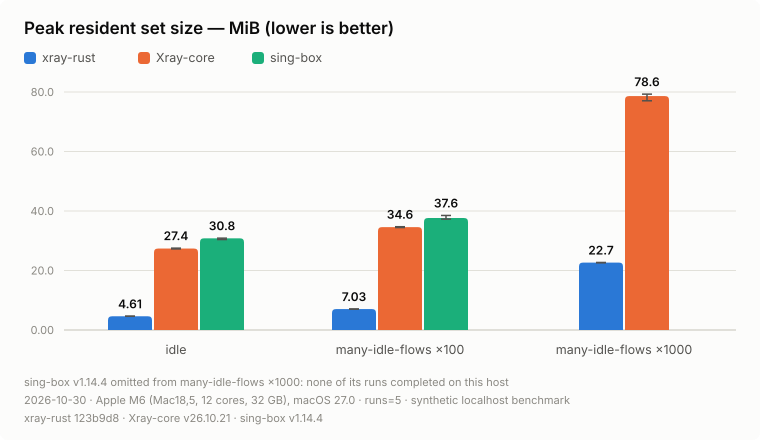
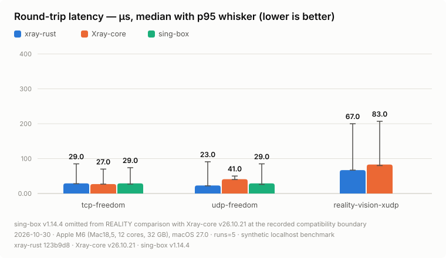
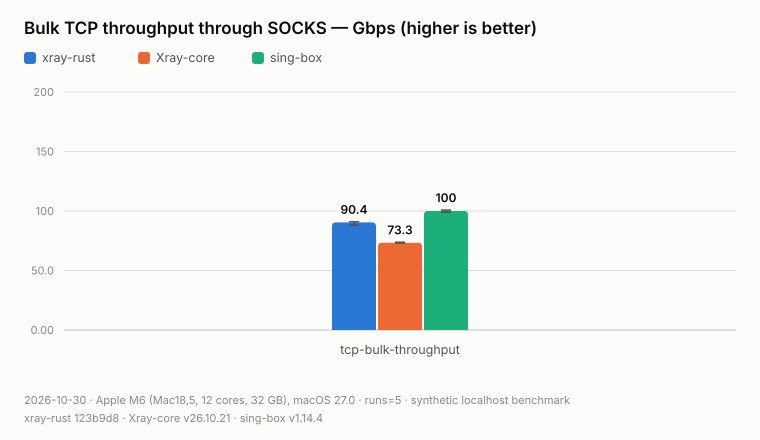
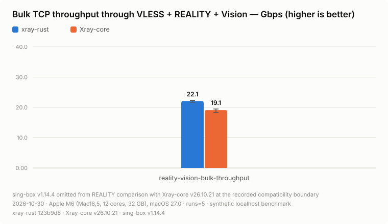
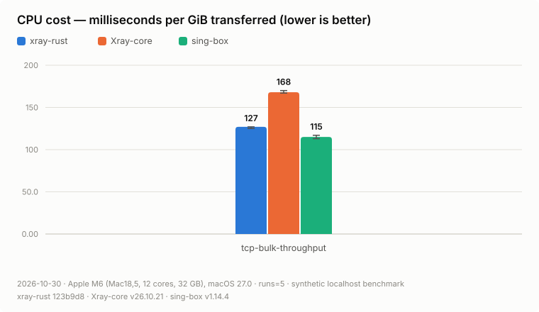
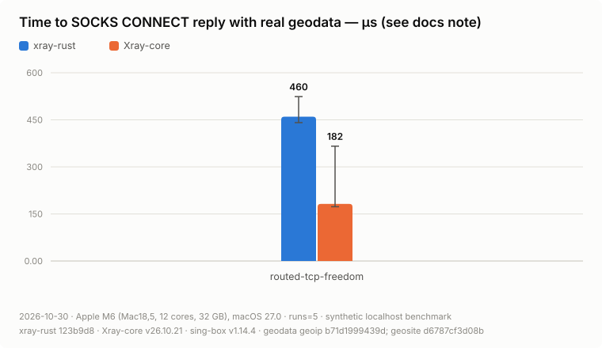
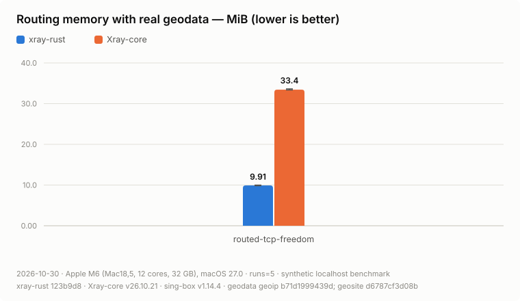

# Three-engine benchmark evidence: Xray-core v26.10.21 and sing-box v1.14.4

This result group repeats the [2026-08-31 RC4 matrix](../2026-08-31-v26.7.28/README.md)
for xray-rust `123b9d8d`, the performance branch measured against `main` in
the [2026-10-30 before/after report](../2026-10-30-perf-branch/README.md).
Measured **2026-10-30 07:35–16:25 America/Chicago** on an Apple M6 MacBook
(Mac18,5, 12 cores, 32 GB RAM, macOS 27.0, 26A425) on AC power. Every
published series has five successful release runs whose summaries record a
clean workspace; values below are five-run medians, and RSS is peak resident
memory.

| Engine | Source | Executable SHA-256 |
| --- | --- | --- |
| xray-rust | `123b9d8d95d3501103e9c8e8e93f8f245426fe31`, isolated release build | `8ea36af1fc504ee5469e75dbaac87df80a4f90a47d31b56b07fc1cf4c76535ca` |
| Xray-core | v26.10.21, `1b1647cd9ddf0abc34b981d4611fc03bcac1ca74`, Go 1.27.3 | `b8c58f14180eb0cad5665fa2cefb7d10897eec945d007212a053fc1de2257ee8` |
| sing-box | stable v1.14.4, `c005f35300ce76427dc285481ec5695f5b179cd2`, Go 1.27.3, tags `with_gvisor,with_utls,badlinkname,tfogo_checklinkname0` | `b163d69ea5a31bdffc40e2d49415330d383ca6399d6b19c1935eb7cb896577b5` |
| Driver | xray-bench from `b01fcd066471473426ab07996cc2608f9d108f59` | `e5a9561f140ef79d62802940d1c1fb0097b3155bb9c7cdf55acd7b52e6cba933` |

The workloads, arguments and run counts are the RC4 group's. These are
same-host process microbenchmarks: they validate payload bytes and measure
process RSS, CPU, setup and transfer timing, not a WAN, packet loss, mobile
energy or a cross-engine TUN path. The host, macOS and comparator versions
all differ from the RC4 group, so its numbers are not a baseline for these.

## Headline charts

<picture>
  <source media="(prefers-color-scheme: dark)" srcset="media/memory-rss-dark.svg">
  
</picture>

<picture>
  <source media="(prefers-color-scheme: dark)" srcset="media/latency-dark.svg">
  
</picture>

<picture>
  <source media="(prefers-color-scheme: dark)" srcset="media/throughput-dark.svg">
  
</picture>

<picture>
  <source media="(prefers-color-scheme: dark)" srcset="media/reality-throughput-dark.svg">
  
</picture>

<picture>
  <source media="(prefers-color-scheme: dark)" srcset="media/cpu-per-gib-dark.svg">
  
</picture>

<picture>
  <source media="(prefers-color-scheme: dark)" srcset="media/geo-setup-latency-dark.svg">
  
</picture>

<picture>
  <source media="(prefers-color-scheme: dark)" srcset="media/geo-memory-dark.svg">
  
</picture>

## Base and reconnect results

| Scenario | Median metric | xray-rust | Xray-core | sing-box |
| --- | --- | ---: | ---: | ---: |
| idle | RSS, MiB | 4.6 | 27.4 | 30.8 |
| many-idle-flows-100 | RSS, MiB | 7.0 | 34.6 | 37.6 |
| many-idle-flows-1000 | RSS, MiB | 22.7 | 78.6 | omitted |
| tcp-freedom | RTT, µs | 29 | 27 | 29 |
| udp-freedom | RTT, µs | 23 | 41 | 29 |
| reconnect-burst | total setup, µs | 1,333 | 987 | 1,313 |
| reality-vision-xudp | RTT, µs | 67 | 83 | omitted |
| tcp-bulk-throughput | throughput, Gbps | 90.4 | 73.3 | 100.0 |
| tcp-bulk-throughput | CPU, ms/GiB | 127 | 168 | 115 |
| reality-vision-bulk-throughput | throughput, Gbps | 22.1 | 19.1 | omitted |
| reality-vision-bulk-throughput | CPU, ms/GiB | 480 | 500 | omitted |
| routed-tcp-freedom | total setup, µs | 884 | 658 | unsupported |
| routed-tcp-freedom | RSS, MiB | 9.9 | 33.4 | unsupported |

xray-rust keeps the lowest resident memory at every scale, 3.5 to 6.7 times
below the Go engines, and the lowest UDP and REALITY XUDP round trips.
Through a full VLESS + REALITY + Vision tunnel it moves 22.1 Gbps against
Xray-core's 19.1 at less CPU per GiB. On plain TCP bulk through SOCKS
sing-box leads at 100.0 Gbps and 115 ms/GiB; xray-rust is second. Setup is
slower than Xray-core's in `reconnect-burst` and `routed-tcp-freedom`:
xray-rust replies to SOCKS CONNECT after routing and dialing, Xray-core before
them (see the measurement asymmetry note in [docs/benchmarks.md](../../../benchmarks.md)).

## Stream transport results

Each cell is `throughput Mbps / peak RSS MiB`. Each flow transfers 4,096 ×
64 KiB in the selected direction; full duplex transfers that amount both ways.

| Scenario | xray-rust | Xray-core | sing-box |
| --- | ---: | ---: | ---: |
| stream-ws-upload-1 | 7,589 / 9.2 | 6,189 / 33.3 | 17,319 / 33.2 |
| stream-ws-upload-32 | 14,901 / 31.7 | 12,303 / 46.5 | 19,618 / 47.0 |
| stream-ws-download-1 | 13,855 / 8.1 | 9,630 / 33.3 | 11,735 / 36.0 |
| stream-ws-download-32 | 16,504 / 12.3 | 13,928 / 44.9 | 14,149 / 47.5 |
| stream-ws-full-duplex-1 | 12,378 / 9.2 | 8,642 / 34.9 | 16,208 / 36.3 |
| stream-ws-full-duplex-32 | 13,287 / 31.3 | 11,348 / 47.2 | 15,265 / 52.8 |
| stream-httpupgrade-upload-1 | 21,914 / 8.4 | 14,511 / 32.8 | 21,692 / 33.4 |
| stream-httpupgrade-upload-32 | 22,104 / 17.6 | 18,973 / 46.2 | 19,896 / 47.0 |
| stream-httpupgrade-download-1 | 20,260 / 8.0 | 14,609 / 32.2 | 19,702 / 34.8 |
| stream-httpupgrade-download-32 | 19,260 / 11.2 | 19,217 / 45.1 | 19,320 / 47.6 |
| stream-httpupgrade-full-duplex-1 | 25,415 / 8.4 | 18,200 / 33.7 | 21,914 / 35.3 |
| stream-httpupgrade-full-duplex-32 | 18,132 / 18.8 | 17,221 / 47.3 | 17,195 / 53.3 |
| stream-grpc-upload-1 | 21,054 / 10.5 | 13,095 / 36.4 | 12,937 / 34.2 |
| stream-grpc-upload-32 | 22,869 / 30.8 | 15,849 / 53.4 | 12,860 / 49.2 |
| stream-grpc-download-1 | 19,347 / 12.8 | 13,339 / 95.6 | 5,916 / 48.7 |
| stream-grpc-download-32 | 18,326 / 11.9 | 15,816 / 651.9 | 5,805 / 469.2 |
| stream-grpc-full-duplex-1 | 23,217 / 14.7 | 16,456 / 89.7 | 8,135 / 51.4 |
| stream-grpc-full-duplex-32 | 20,459 / 35.0 | 10,767 / 250.2 | omitted |
| stream-xhttp-h1-upload-1 | 13,592 / 9.1 | 7,183 / 33.9 | unsupported |
| stream-xhttp-h1-upload-32 | 19,239 / 19.9 | 14,308 / 54.4 | unsupported |
| stream-xhttp-h1-download-1 | 10,632 / 8.9 | 8,389 / 33.8 | unsupported |
| stream-xhttp-h1-download-32 | 14,910 / 14.4 | 14,897 / 52.3 | unsupported |
| stream-xhttp-h1-full-duplex-1 | 12,099 / 9.2 | 8,766 / 35.1 | unsupported |
| stream-xhttp-h1-full-duplex-32 | 16,388 / 20.3 | 14,492 / 55.0 | unsupported |
| stream-xhttp-h2-upload-1 | 11,303 / 10.0 | 8,013 / 35.0 | unsupported |
| stream-xhttp-h2-upload-32 | 13,480 / 18.5 | 10,305 / 62.9 | unsupported |
| stream-xhttp-h2-download-1 | 9,989 / 12.1 | 6,335 / 35.1 | unsupported |
| stream-xhttp-h2-download-32 | 21,991 / 25.1 | 9,683 / 64.2 | unsupported |
| stream-xhttp-h2-full-duplex-1 | 11,640 / 12.2 | 8,059 / 36.2 | unsupported |
| stream-xhttp-h2-full-duplex-32 | 14,011 / 27.5 | 7,251 / 63.8 | unsupported |
| stream-xhttp-h3-upload-1 | 3,926 / 11.9 | 1,841 / 37.8 | unsupported |
| stream-xhttp-h3-upload-32 | 2,798 / 163.3 | 2,003 / 49.9 | unsupported |
| stream-xhttp-h3-download-1 | 2,545 / 9.4 | 2,085 / 38.2 | unsupported |
| stream-xhttp-h3-download-32 | 2,329 / 16.9 | 1,988 / 47.3 | unsupported |
| stream-xhttp-h3-full-duplex-1 | 3,619 / 12.1 | 2,452 / 38.5 | unsupported |
| stream-xhttp-h3-full-duplex-32 | 2,932 / 145.5 | 2,276 / 51.3 | unsupported |

xray-rust is ahead of Xray-core in every stream scenario except the 32-flow
HTTPUpgrade and XHTTP H1 downloads, where the two are level, and uses less
memory in all but two. sing-box leads WebSocket uploads and duplex transfers;
on HTTPUpgrade it is level with xray-rust or behind it.

In the RC4 group, on another host, xray-rust's one-flow gRPC download trailed
Xray-core's (7,018 against 12,860 Mbps). With the branch's gRPC windows it
leads, 19,347 against 13,339, at 12.8 against 95.6 MiB. The 32-flow XHTTP H3
upload and duplex RSS, 163.3 and 145.5 MiB against Xray-core's 49.9 and 51.3,
was the visible gap at `123b9d8d`: every XHTTP H3 request has its own QUIC
connection, and each kept a send window of at least 2 MiB. RC4 measured 172.4
and 185.9 MiB.

**Later on the branch:** `bae0ed5b` shares a 16 MiB send budget between XHTTP
H3 uploads. On this host, with the same driver and Xray-core server, the
[send-budget report](../2026-10-30-xhttp-h3-send-budget/README.md) measured
these two scenarios at 87.7 and 78.2 MiB instead of 162.1 and 140.6, at the
same throughput. That narrows the gap to Xray-core without closing it; the
two rows above describe xray-rust before the change.

## XHTTP packet pressure

Each cell is `throughput Mbps / peak RSS MiB / CPU ms`. Every flow uploads
4,096 × 16 KiB paced packet-up writes.

| Scenario | xray-rust | Xray-core |
| --- | ---: | ---: |
| xhttp-pressure-xhttp-h1-1 | 5 / 9.9 / 1,160 | 5 / 37.6 / 2,900 |
| xhttp-pressure-xhttp-h1-32 | 130 / 18.2 / 20,790 | 122 / 58.3 / 97,670 |
| xhttp-pressure-xhttp-h2-1 | 5 / 10.4 / 1,550 | 5 / 37.9 / 3,150 |
| xhttp-pressure-xhttp-h2-32 | 130 / 16.9 / 19,630 | 119 / 81.6 / 40,750 |
| xhttp-pressure-xhttp-h3-1 | 5 / 10.5 / 2,820 | 4 / 39.7 / 9,030 |
| xhttp-pressure-xhttp-h3-32 | 134 / 28.7 / 54,420 | omitted |

Pacing sets the throughput; xray-rust spends 2.0 to 4.7 times less CPU on it.

## XHTTP bounded-memory profile

Each cell is `peak RSS MiB / duration ms`; packet-up rows also show throughput.

| Scenario | xray-rust | Xray-core |
| --- | ---: | ---: |
| held-open, 1 flow, max 500000 | 6.4 / 35,012 | 28.4 / 35,517 |
| held-open, 16 flows, max 500000 | 8.2 / 35,016 | 33.2 / 35,519 |
| held-open, 32 flows, max 500000 | 9.3 / 35,017 | 35.6 / 35,524 |
| held-open, 16-flow control, max 16384 | 8.1 / 35,015 | 33.2 / 35,520 |
| packet-up, 1 flow, max 500000 | 7.7 / 66,982 / 3 Mbps | 32.9 / 68,070 / 3 Mbps |
| packet-up, 16 flows, max 500000 | 10.3 / 67,811 / 34 Mbps | 40.7 / 78,798 / 29 Mbps |

The 16-flow held-open control and the 500000-byte ceiling stay equal for
xray-rust (8.1 against 8.2 MiB): the ceiling is not pinned per idle flow.

## Reviewed omissions

- **sing-box, both REALITY workloads.** Xray-core v26.9.8 dropped the
  automatic `minClientVer` floor that excluded sing-box in the RC4 group, but
  its REALITY server requires an `X25519MLKEM768` key share, which sing-box's
  REALITY client removes from its ClientHello
  (`common/tls/reality_client.go`). A one-run probe confirmed it: the server
  sent the connection to its cover origin, and sing-box reported
  `reality verification failed`. The probe is retained outside Git.
- **sing-box, `many-idle-flows-1000`.** Three attempts, one beside the other
  engines and two alone after 90 seconds, each failed in its first run: the
  harness target reset sing-box's direct outbound connections, logged within
  a few milliseconds of each other, and the client received a SOCKS general
  failure. The likely limit is the macOS listen queue, 128 connections
  (`kern.ipc.somaxconn`); it was not raised. The chart leaves this bar out
  with `--omit-sing-box-1000-flows`.
- **sing-box, `stream-grpc-full-duplex-32`.** Its fourth run hit the
  300-second timeout, as both RC4 campaigns did after three and four runs.
- **Xray-core, `xhttp-pressure-xhttp-h3-32`.** It reset the completion-marker
  connection in its first run, as in the RC4 group.
- sing-box implements neither XHTTP nor the Xray `.dat` geodata, so those
  cells are compatibility boundaries rather than failed series.

## Re-measured and per-engine series

- The 1,000-flow series ran one engine at a time, 90 seconds apart. In the
  compare group Xray-core's third run, after xray-rust's five, failed with a
  reset SOCKS handshake and 4,800 sockets in TIME_WAIT; macOS has 16,384
  ephemeral ports. xray-rust measured 22.7 MiB in both forms.
- `stream-ws-upload-1` and `stream-ws-upload-32` were measured again after the
  other groups. The repository changed during their first runs: the first
  recorded a dirty workspace, and a commit during the second made its
  provenance mixed, which the harness refuses to summarize. All 138 published
  summaries record a clean workspace: 26 at `9f726828`, 112 at `5bbbf678`.
  The commits between them change documentation and scripts only.
- Before every group a controller waited until the migration collector's load
  rule (no external process at one core, no two cores in total, no compiler)
  had passed for 30 seconds; the per-engine 1,000-flow runs waited 90 seconds
  instead.

## Evidence and replay

- [`commands.sh`](commands.sh) records the inputs, hashes and arguments of
  every published series, the diagnostic probe and the chart rendering. The
  charts were rendered by xray-bench from `f99a2729`, which adds
  `--omit-sing-box-1000-flows`.
- `chart-inputs/` holds the 138 reviewed `summary.json` files; each embeds
  its five raw results and provenance.
- The raw result directories, controller scripts and logs stay outside Git
  under `target/benchmarks/2026-10-30-three-engine/`. There is no
  machine-validated manifest: `scripts/check-benchmark-publication.py` pins
  the RC4 comparators.
