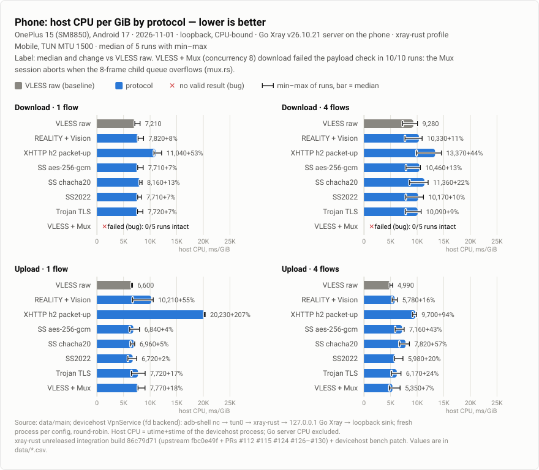
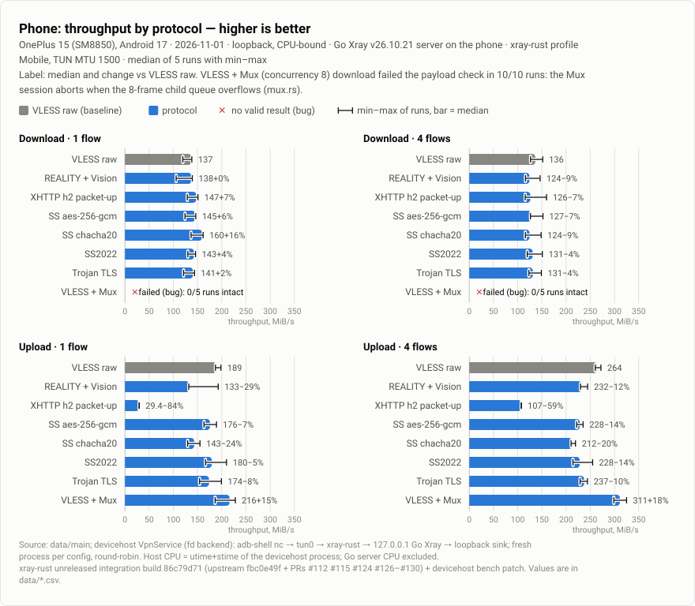
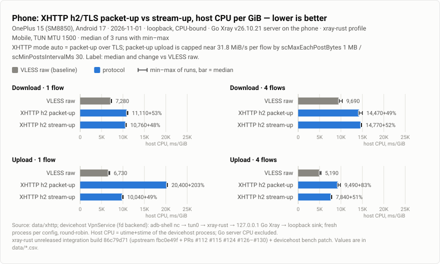
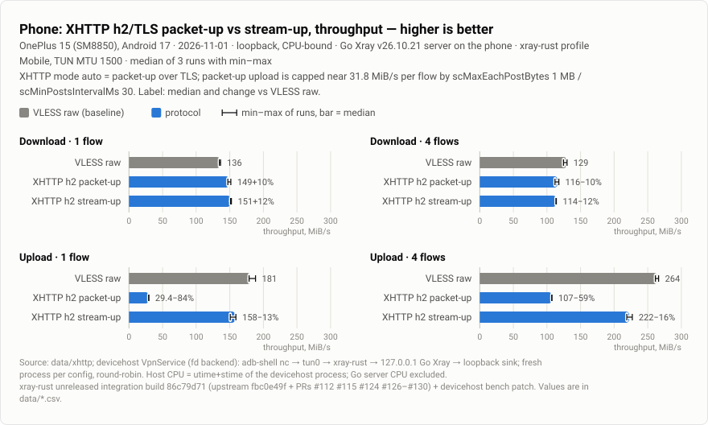
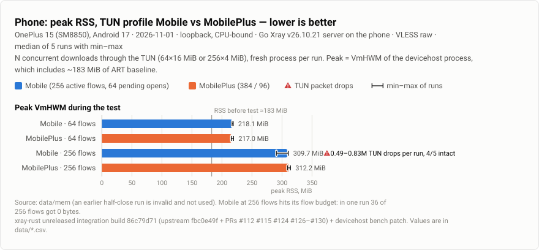

# Android protocol costs through the TUN on a OnePlus 15

Measured **2026-11-01 12:32–13:42 UTC** on a physical OnePlus 15 (CPH2745,
Snapdragon SM8850, Android 17, `CLK_TCK` 100) on USB power, against a Go
Xray-core v26.10.21 server running on the same phone. This is the first
throughput and CPU-per-GiB comparison of protocols through the Android TUN on
a physical device in this repository. The earlier
[Samsung LAN report](../../../device-results/2026-10-04-android-v08/README.md)
covered function and bounded request resources, not bulk cost.

The measured library is **not a released build and not `main`**. It is a local
integration branch: `main` at `fbc0e49f` plus eight open pull requests,
including the classic Shadowsocks AEAD client (#129) and VLESS Mux (#130) that
two of the measured rows need. Treat these numbers as development evidence
for those pull requests and for the shared TUN and Mux runtime. They are not
release acceptance.

- **Integrity.** Every download was checked by the MD5 of each flow against
  zeros of the expected length (1 GiB or 256 MiB); every upload by the server
  answering `N + 36` bytes. No protocol-series process recorded a TUN drop or
  a fatal TUN error (`tunDroppedPackets = 0`, `fatalTunErrors = 0` in all 49).
- **Protocol cost on downloads is small.** REALITY + Vision, Shadowsocks
  (AEAD-2017 and 2022) and Trojan TLS cost 7–13% more host CPU per GiB than
  VLESS raw with one flow and 9–22% with four. Most of the phone's cost is the
  TUN path itself.
- **XHTTP h2/TLS costs most:** downloads +44…+53%. Uploads in `mode: auto`
  (packet-up over TLS) stop at the POST limit: about 29.4 MiB/s per flow at
  +207% CPU. `stream-up` reaches 158 MiB/s at +49%.
- **Shadowsocks AEAD-2017 against SS2022:** equal on downloads
  (7,710 ms/GiB), at parity on single uploads; on four-flow uploads AEAD-2017
  costs more (aes-256-gcm 7,160, chacha20 7,820 against SS2022's 5,980).
- **VLESS + Mux (concurrency 8) downloads failed: 0 of 10 runs passed.**
  The Mux session resets after about 30 ms and the client receives 0.3–0.5 MiB.
  The cause is in the shared Mux runtime on `main`, so it affects Trojan,
  SS2022 and VMess Mux as well; the fix is proposed in
  [#138](https://github.com/aimalygin/xray-rust/pull/138). Mux uploads work:
  one TCP connection instead of four, +18% (×1) and +7% (×4) CPU, +15…+18%
  throughput.
- **Memory, `Mobile` against `MobilePlus`:** the peaks are almost equal
  (64 flows ≈ 218/217 MiB, 256 flows ≈ 310/312 MiB), but `Mobile` hits its
  flow budget at 256 flows (`max_active_flows` 256, `max_pending_opens` 64):
  0.49–0.83 million dropped TUN packets in every run, and in one of five runs
  36 of 256 flows received no byte. `MobilePlus` (384/96) dropped nothing.

## Build and environment

| Component | Identity |
| --- | --- |
| xray-rust | `86c79d715d2d0eb29e4414079f6fa24ba2faeb42`, local branch, not pushed: `fbc0e49f02200351dc17754f6d1b1ac3113b54c8` (`main`, merge of #133) with the eight pull requests below merged in this order |
| `libxray_ffi.so` | arm64-v8a, release, Rust 1.96.0, NDK 26.3.11579264, 16 KiB LOAD alignment, built by `scripts/build-android-adapter.sh`; SHA-256 `88845bd553c408b3aafc665acf7b2327dc9db0bd2e2a70f4a3914c778b8f78d3` (the build output; the installed APK was not retained) |
| Host application | `devicehost` Debug APK, arm64 only, with the uncommitted [bench patch](scripts/devicehost-bench.patch) |
| Server | Xray-core v26.10.21, `1b1647cd9ddf0abc34b981d4611fc03bcac1ca74`, Go 1.27.3, `GOOS=android GOARCH=arm64`, `-ldflags -checklinkname=0`; binary hash not recorded |
| Device | OnePlus 15, CPH2745, SM8850, Android 17, charge 85% (built-in charge limit), battery 30.1 → 34.2 °C in the protocol series, 33.6–34.3 °C in the memory series |

| PR | Head merged | Change |
| --- | --- | --- |
| [#112](https://github.com/aimalygin/xray-rust/pull/112) | `a689e38f` | runtime: handshake 0 no longer fails every UDP open |
| [#115](https://github.com/aimalygin/xray-rust/pull/115) | `a1223c22` | WireGuard split tunnel with remote DNS outside `allowedIPs` |
| [#124](https://github.com/aimalygin/xray-rust/pull/124) | `3cccc510` | XHTTP over HTTP/3 UDP hop |
| [#126](https://github.com/aimalygin/xray-rust/pull/126) | `b35a8a0d` | Android TUN interface contract and live traffic counters |
| [#127](https://github.com/aimalygin/xray-rust/pull/127) | `c2ca4685` | cancel in-flight outbound probes (ABI 1.15) |
| [#128](https://github.com/aimalygin/xray-rust/pull/128) | `c8d1609c` | live bytes of active connections in per-outbound accounting |
| [#129](https://github.com/aimalygin/xray-rust/pull/129) | `c3e38372` | classic Shadowsocks AEAD client methods |
| [#130](https://github.com/aimalygin/xray-rust/pull/130) | `5a3c8db7` | Mux.Cool and the XUDP pool for the VLESS outbound |

The Shadowsocks AEAD-2017 and VLESS + Mux rows exist only because of #129
and #130. The other six pull requests are on the branch because the client
application carries them; their effect on these numbers was not isolated.

## Method

The server runs on the phone itself, on `127.0.0.1:10001–10007` under
`adb shell` (UID 2000). Over Wi-Fi between a Mac and the phone the link gave
3.5–7 MiB/s, and on a slow link CPU per GiB is 4–6 times higher, so the
protocol share would be lost in the link. Loopback keeps the phone
CPU-bound. The metric is the CPU of the `org.xrayrust.devicehost` process,
which hosts xray-rust; the Go server's CPU is recorded separately and is not
part of it.

```
adb shell (UID 2000): toybox nc → 203.0.113.10:PORT   (TEST-NET-3, the only VPN route)
  → tun0 (MTU 1500) → xray-rust (devicehost, profile Mobile) → protocol outbound
  → 127.0.0.1:1000X Go Xray (protocol inbound) → freedom redirect 127.0.0.1:PORT
  → toybox nc -L (loopback, outside the VPN)
```

- Only `com.android.shell` and the route `203.0.113.0/24` enter the VPN. The
  Go server's access log tags each connection with its inbound, which
  confirms that every configuration reached its own inbound. Mux was in use (one server TCP connection for four upload flows). REALITY
  logged no `processed invalid connection`.
- TUN: profile `Mobile`, MTU 1500, default buffers, FileDescriptor backend.
- REALITY target `23.210.17.55:443` (Akamai, www.apple.com),
  `serverNames: [www.apple.com]`; client `fingerprint: chrome`,
  `flow: xtls-rprx-vision`.
- TLS for XHTTP and Trojan: a self-signed `bench.test` leaf pinned on the
  client with `pinnedPeerCertSha256`, without `allowInsecure`. XHTTP uses
  `alpn: h2` and `mode: auto`, which is packet-up over TLS
  (`crates/xray-transport/src/stream/xhttp/config.rs:303`), and separately
  `stream-up`.
- Go freedom 26.10 blocks private addresses by default, so the server adds
  `finalRules: [{action: allow, ip: [127.0.0.1/32]}]`.
- All credentials (UUID, x25519 keys, passwords, the SS2022 key and the
  certificate) were generated for this run.

Load per process: 10 s idle → download ×1 (1 GiB) → download ×4
(4 × 256 MiB) → upload ×1 (1 GiB) → upload ×4 (4 × 256 MiB). Each
configuration gets a fresh process; configurations run round-robin, shifted
by one on every repeat; five repeats. Clients never half-close: Mux.Cool has
no half-close, and Go freedom keeps a connection for `downlinkOnly` = 1 s
after the client's FIN.

- **CPU:** host `utime + stime` from `/proc/<pid>/stat`, in milliseconds per
  GiB of payload.
- **Throughput:** bytes / (t1 − t0).
- **Peak RSS:** `VmHWM`, which includes about 185 MiB of the devicehost ART
  process before any traffic.
- A run that fails the MD5 or byte-count check is excluded. `bytes=0` on
  `mode=dl` lines of `raw.txt` is an unused script argument: the port sets
  the size (5401 = 1 GiB, 5402 = 256 MiB).

## Protocol series: median of 5 (min–max)

CPU is xray-rust (devicehost) in ms/GiB; Δ is against VLESS raw; "Server" is
the Go Xray server's CPU in ms/GiB.

<picture>
  <source media="(prefers-color-scheme: dark)" srcset="media/protocols-cpu-dark.svg">
  
</picture>

<picture>
  <source media="(prefers-color-scheme: dark)" srcset="media/protocols-throughput-dark.svg">
  
</picture>

### Download

| Protocol | Flows | CPU, ms/GiB | Δ | MiB/s | Server |
| --- | ---: | ---: | ---: | ---: | ---: |
| VLESS raw | 1 | 7,210 (7,130–8,120) | — | 137 (120–138) | 790 |
| VLESS + Mux | 1 | **failed, 0/5** | | | |
| VLESS + REALITY + Vision | 1 | 7,820 (7,740–8,770) | +8% | 138 (106–139) | 1,580 |
| VLESS + XHTTP h2/TLS (packet-up) | 1 | 11,040 (10,720–12,160) | +53% | 147 (129–151) | 5,670 |
| SS aes-256-gcm | 1 | 7,710 (7,670–8,700) | +7% | 145 (124–146) | 1,900 |
| SS chacha20-ietf-poly1305 | 1 | 8,160 (8,050–8,500) | +13% | 160 (137–162) | 3,560 |
| SS2022 blake3-aes-256-gcm | 1 | 7,710 (7,670–8,370) | +7% | 143 (130–146) | 1,780 |
| Trojan TLS | 1 | 7,720 (7,640–8,630) | +7% | 141 (121–144) | 1,830 |
| VLESS raw | 4 | 9,280 (7,280–10,060) | — | 136 (127–152) | 790 |
| VLESS + Mux | 4 | **failed, 0/5** | | | |
| VLESS + REALITY + Vision | 4 | 10,330 (7,720–10,940) | +11% | 124 (116–146) | 1,510 |
| VLESS + XHTTP (packet-up) | 4 | 13,370 (9,880–14,550) | +44% | 126 (116–160) | 5,550 |
| SS aes-256-gcm | 4 | 10,460 (7,900–10,610) | +13% | 128 (127–152) | 1,840 |
| SS chacha20 | 4 | 11,360 (8,590–12,060) | +22% | 125 (116–149) | 3,720 |
| SS2022 | 4 | 10,170 (7,870–11,190) | +10% | 131 (120–151) | 1,740 |
| Trojan TLS | 4 | 10,090 (7,850–10,750) | +9% | 131 (123–149) | 1,740 |

### Upload

| Protocol | Flows | CPU, ms/GiB | Δ | MiB/s | Server | TCP to server |
| --- | ---: | ---: | ---: | ---: | ---: | ---: |
| VLESS raw | 1 | 6,600 (6,520–6,700) | — | 189 (187–199) | 2,520 | 1 |
| VLESS + Mux | 1 | 7,770 (7,730–9,050) | +18% | 216 (186–228) | 5,350 | 1 |
| VLESS + REALITY + Vision | 1 | 10,210 (6,710–10,590) | +55% | 133 (132–193) | 4,030 | 1 |
| VLESS + XHTTP (packet-up) | 1 | 20,230 (20,170–20,350) | +207% | 29.4 (29.4–29.5) | 21,350 | — |
| SS aes-256-gcm | 1 | 6,840 (6,170–8,000) | +4% | 176 (163–189) | 5,360 | 1 |
| SS chacha20 | 1 | 6,960 (6,330–7,110) | +5% | 143 (130–155) | 6,250 | 1 |
| SS2022 | 1 | 6,720 (5,830–7,470) | +2% | 180 (167–210) | 5,320 | 1 |
| Trojan TLS | 1 | 7,720 (6,500–9,070) | +17% | 174 (154–199) | 5,760 | 1 |
| VLESS raw | 4 | 4,990 (4,880–5,390) | — | 264 (260–272) | 2,540 | 4 |
| VLESS + Mux | 4 | 5,350 (4,780–6,790) | +7% | 311 (299–325) | 3,850 | **1** |
| VLESS + REALITY + Vision | 4 | 5,780 (5,300–6,280) | +16% | 232 (230–244) | 3,490 | 4 |
| VLESS + XHTTP (packet-up) | 4 | 9,700 (9,170–9,900) | +94% | 107 (107–108) | 8,520 | — |
| SS aes-256-gcm | 4 | 7,160 (5,860–7,560) | +43% | 228 (222–235) | 5,250 | 4 |
| SS chacha20 | 4 | 7,820 (6,660–8,540) | +57% | 212 (210–220) | 6,440 | 4 |
| SS2022 | 4 | 5,980 (5,780–7,330) | +20% | 228 (214–255) | 4,480 | 4 |
| Trojan TLS | 4 | 6,170 (5,180–6,970) | +24% | 237 (229–244) | 4,560 | 4 |

### Peak host RSS over the four cases, MiB (median)

| Protocol | RSS after start | Peak `VmHWM` |
| --- | ---: | ---: |
| VLESS raw | 186.0 | 203.3 (201.3–205.1) |
| VLESS + Mux | 185.7 | 204.2 |
| REALITY + Vision | 185.8 | 207.0 |
| XHTTP packet-up | 185.9 | **237.3** (234.5–239.2) |
| SS aes-256-gcm | 185.7 | 203.8 |
| SS chacha20 | 185.4 | 203.2 |
| SS2022 | 185.8 | 203.2 |
| Trojan TLS | 185.1 | 205.6 |

## XHTTP: packet-up (`auto`) against `stream-up`, 3 repeats

A separate series (`data/xhttp`) with its own VLESS raw baseline. Each cell
is `ms/GiB · MiB/s`.

| Case | VLESS raw | XHTTP `auto` (packet-up) | XHTTP `stream-up` |
| --- | --- | --- | --- |
| download ×1 | 7,280 · 136 | 11,110 (+53%) · 149 | 10,760 (+48%) · 151 |
| download ×4 | 9,690 · 129 | 14,470 (+49%) · 116 | 14,770 (+52%) · 114 |
| upload ×1 | 6,730 · 181 | 20,400 (+203%) · **29.4** | 10,040 (+49%) · **158** |
| upload ×4 | 5,190 · 264 | 9,490 (+83%) · 107 | 7,840 (+51%) · 222 |
| peak RSS, MiB | 207.6 | 239.3 | 211.9 |

29.4 MiB/s per flow is the packet-up ceiling at the defaults:
`scMaxEachPostBytes` 1,000,000 with `scMinPostsIntervalMs` 30 allows about
31.8 MiB/s.

<picture>
  <source media="(prefers-color-scheme: dark)" srcset="media/protocols-xhttp-cpu-dark.svg">
  
</picture>

<picture>
  <source media="(prefers-color-scheme: dark)" srcset="media/protocols-xhttp-throughput-dark.svg">
  
</picture>

## Memory: `Mobile` against `MobilePlus`

VLESS raw on the same setup. N concurrent downloads: 64 × 16 MiB or
256 × 4 MiB. A fresh process per case, five repeats, RSS sampled every
0.25 s.

| Profile : flows | Intact runs | RSS before, MiB | Peak `VmHWM`, MiB | Peak − before | MiB/s | CPU, ms/GiB | TUN drops |
| --- | ---: | ---: | ---: | ---: | ---: | ---: | --- |
| `Mobile` : 64 | 5/5 | 182.9 | 218.1 (216.9–218.8) | +34.8 | 94.0 | 17,700 | 0 |
| `MobilePlus` : 64 | 5/5 | 183.1 | 217.0 (215.6–219.3) | +33.4 | 92.5 | 17,700 | 0 |
| `Mobile` : 256 | **4/5** | 182.9 | 309.7 (290.7–310.6) | +125.8 | 63.9 | 26,320\* | **0.49–0.83 million in every run** |
| `MobilePlus` : 256 | 5/5 | 183.3 | 312.2 (309.3–314.2) | +129.0 | 60.8 | 35,520 | 0 |

<picture>
  <source media="(prefers-color-scheme: dark)" srcset="media/protocols-memory-dark.svg">
  
</picture>

- The profiles do not differ in memory. At 256 flows the peaks are 2.5 MiB
  apart; from 64 to 256 flows the peak grows by about 0.48–0.50 MiB per
  additional flow.
- `Mobile` runs into its flow budget at 256 flows
  (`crates/xray-core-rs/src/tun.rs:205–212`): hundreds of thousands of TUN
  drops, and in run 3 36 of 256 flows received 0 bytes. The sampled maximum
  of established server connections stayed at 219–224 in three of five
  `Mobile` runs; it is sampled once a second, so it is only indicative.
  \* `Mobile` uses less CPU at 256 flows because part of the work was
  dropped; do not compare it directly.
- `MobilePlus` carried all 256 flows without a drop.
- The first memory attempt is invalid and not published: its clients
  half-closed, and Go's `downlinkOnly` timer of 1 s cut the flows. The data
  above is from the repeat.

## VLESS + Mux download failure

Both download cases failed their payload check in all five repeats (0/10):
the session ends about 30 ms after the start, the client receives 0.3–0.5 MiB
of 1 GiB, and the Go server logs
`common/mux: session N ends. > io: read/write on closed pipe`. Uploads pass.

The cause is in `crates/xray-core-rs/src/outbound/mux.rs`: when a Keep frame
arrives for a child whose receive queue already holds `CHILD_QUEUE` = 8
frames, the reader marks the child failed and sends END. Through the TUN the
local consumer (smoltcp) is slower than the server, so a bulk download
overflows that queue at once. This code came to `main` in `30cde188` (v0.8
Trojan/SS2022/VMess Mux); #130 does not change it (in `mux.rs` it only edits
an XHTTP error). It is therefore an existing bug of the shared Mux runtime
that also affects Trojan, SS2022 and VMess Mux on `main`; #130 only exposes it
for VLESS. [#138](https://github.com/aimalygin/xray-rust/pull/138) pauses the
reader instead, as Xray-core's blocking pipe write does, and adds a
slow-consumer interop test. This series was not repeated with #138.

## Findings

1. Protocol cost against VLESS raw on downloads (1 / 4 flows): REALITY +
   Vision +8/+11%, SS2022 +7/+10%, SS aes-256-gcm +7/+13%, Trojan TLS
   +7/+9%, SS chacha20 +13/+22%, XHTTP h2/TLS +53/+44%.
2. Uploads: REALITY + Vision ×1 is +55% but bimodal (three of five runs at
   about 10.2 s/GiB and 133 MiB/s, two at the raw level); it needs its own
   investigation (Vision padding or TLS record size). Shadowsocks AEAD-2017
   ×4 is +43…+57% against +20% for SS2022: its chunks of at most 16 KiB
   (`0x3FFF`) add more AEAD tags per byte.
3. Shadowsocks AEAD-2017 against SS2022 (#129): parity on downloads and
   single uploads; SS2022 is cheaper on four-flow uploads, by 16% against
   aes-256-gcm and by 24% against chacha20. The CPU cost of #129 is
   acceptable; SS2022 remains the better choice where the server allows it.
4. Mux: uploads work (one TCP connection instead of four at +7…+18% CPU);
   bulk downloads through the TUN do not, because the session is reset when
   a child's 8-frame queue overflows (`mux.rs`, shared by every Mux protocol
   since `30cde188`). It needs back-pressure, as Go's blocking write provides,
   and a test with a consumer slower than the server; #138 proposes both.
   Client applications should keep Mux disabled until it is fixed.
5. XHTTP over TLS on Android: set `stream-up` explicitly (or use REALITY,
   where `auto` is stream-one). Uploads are five times faster, CPU is half
   and the peak RSS is 27 MiB lower.
6. TUN profile: `MobilePlus` costs no more memory and carries 256 concurrent
   TCP flows without loss; `Mobile` loses packets and flows at 256.
   Applications using `Mobile` should consider `MobilePlus`.

## Caveats

- Synthetic loopback: client, server and sinks share one SoC. On a real link
  CPU per GiB is several times higher and the protocol's share smaller. The
  Wi-Fi series was dropped.
- The payload is zeros without TLS, so Vision's XTLS splice is not engaged
  (the worst case for Vision on the server; on the client, splice is
  impossible inside a TUN anyway).
- Four-flow downloads are bimodal in every configuration (minima of about
  7.3–8.6 s/GiB against medians of 9–11). This looks like core placement and
  the CPU governor, which were not pinned (no root); the round-robin order
  evens it out between protocols.
- Battery temperature rose from 30 to 34 °C; throttling was not controlled.
  Profile `Mobile` in all protocol series. The client is toybox `nc` (4 KiB
  blocks, Nagle enabled).

## Evidence and replay

- [`data/main/`](data/main/raw.txt), [`data/xhttp/`](data/xhttp/raw.txt) and
  [`data/mem/`](data/mem/raw.txt): `raw.txt` holds every result line and the
  MD5 or byte count of every flow; `samples.txt` the first and last
  `XRAY_ANDROID_SAMPLE` of each process (TUN drops, fatal errors);
  `battery.txt` the battery state when each process started.
- `data/protocols-*.csv` hold every charted value, computed from `raw.txt`
  (Mux download rows have `status=failed`). The charts and CSVs were checked
  against the tables above: 392 values agree; six MiB/s values agree only
  after rounding twice (the tables were rounded from one-decimal output).
- [`scripts/`](scripts): `series.sh` and `memseries.sh` drive the phone over
  adb; `phone/servers.sh`, `phone/bench.sh` and `phone/memtest.sh` run on the
  phone; `hostctl.sh` starts one host process for debugging; `analyze.py`
  and `analyze_mem.py` print the tables.
- [`scripts/devicehost-bench.patch`](scripts/devicehost-bench.patch) adds the
  `exp-config-b64` and `exp-profile` extras, takes the client JSON from the
  intent instead of the encrypted store, and limits the VPN to
  `com.android.shell` and `203.0.113.0/24`. It is test-only and applies to
  `main` with `git apply --check`.
- [`configs/`](configs): the server config and the client configs as run;
  `series.sh` fills in the `SERVER` address. The generated credentials, the
  `bench.test` certificate and its key are not published: the configs carry
  `<uuid>`, `<reality-private-key>`, `<reality-public-key>`,
  `<ss-password>`, `<ss2022-base64-key>`, `<trojan-password>` and
  `<bench.test-certificate-sha256>` in their place.
- Not in Git: the smoke runs, the invalid half-close memory run, the
  console logs and the Go server's access log (761 KiB).

To repeat, build the native library from the integration commit, the
`devicehost` Debug APK with the patch applied
(`-Pandroid.injected.build.abi=arm64-v8a`, `XRAY_FFI_ANDROID_DIR` pointing
to it), and Xray-core v26.10.21 for `android/arm64`. Fill in the
placeholders with fresh values: `xray uuid`, `xray x25519` for the REALITY
pair, `openssl rand -base64 32` for the SS2022 key, any password for the
others, and the SHA-256 of the new certificate's DER encoding for the pin:

```sh
openssl req -x509 -newkey ec -pkeyopt ec_paramgen_curve:prime256v1 -nodes \
  -keyout bench.key -out bench.crt -days 30 \
  -subj "/O=bench/CN=bench.test" -addext "subjectAltName=DNS:bench.test"
openssl x509 -in bench.crt -outform DER | shasum -a 256
```

Copy `xray`, `configs/server-phone.json` as `server.json`, `bench.crt`,
`bench.key` and `scripts/phone/*.sh` to `/data/local/tmp/protob`, grant the
VPN consent once, then from the result directory:

```sh
export ANDROID_SERIAL=<serial>
adb shell sh /data/local/tmp/protob/servers.sh &
scripts/series.sh out/main 5 127.0.0.1 loop vless-raw vless-mux reality-vision \
  xhttp-tls-h2 ss-aes256gcm ss-chacha20 ss2022-aes256 trojan-tls
scripts/series.sh out/xhttp 3 127.0.0.1 loop vless-raw xhttp-tls-h2 xhttp-tls-h2-streamup
scripts/memseries.sh out/mem 5 vless-raw Mobile:64 MobilePlus:64 Mobile:256 MobilePlus:256
python3 -I scripts/analyze.py out/main loop
python3 -I scripts/analyze_mem.py out/mem
```

`python3 -I scripts/analyze.py data/main loop` reproduces the protocol tables
from the published data.

## Not covered

- Real networks: the Wi-Fi series was dropped, and no cellular link was
  measured.
- Other TUN profiles than `Mobile` in the protocol series, the PacketPump
  backend, UDP, VMess, Hysteria2, WireGuard and XHTTP over HTTP/3.
- Energy, thermal throttling and a six-hour run; this is not release evidence
  under the [physical-device gate](../../../mobile-testing.md#physical-device-release-evidence).
- The Mux fix in #138 on the phone.
